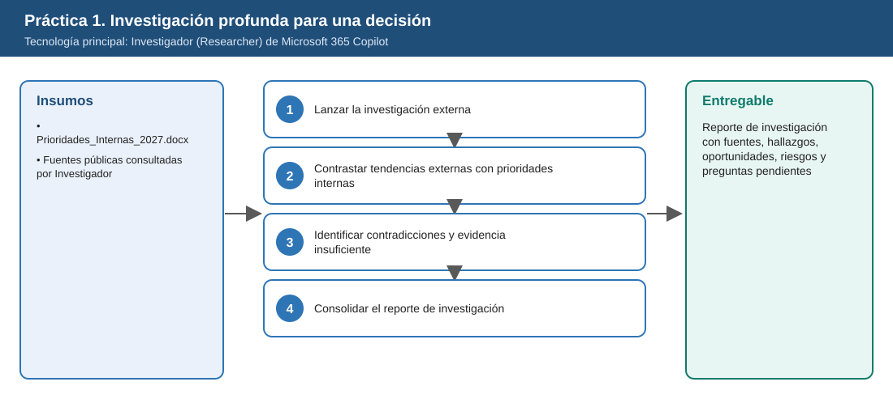
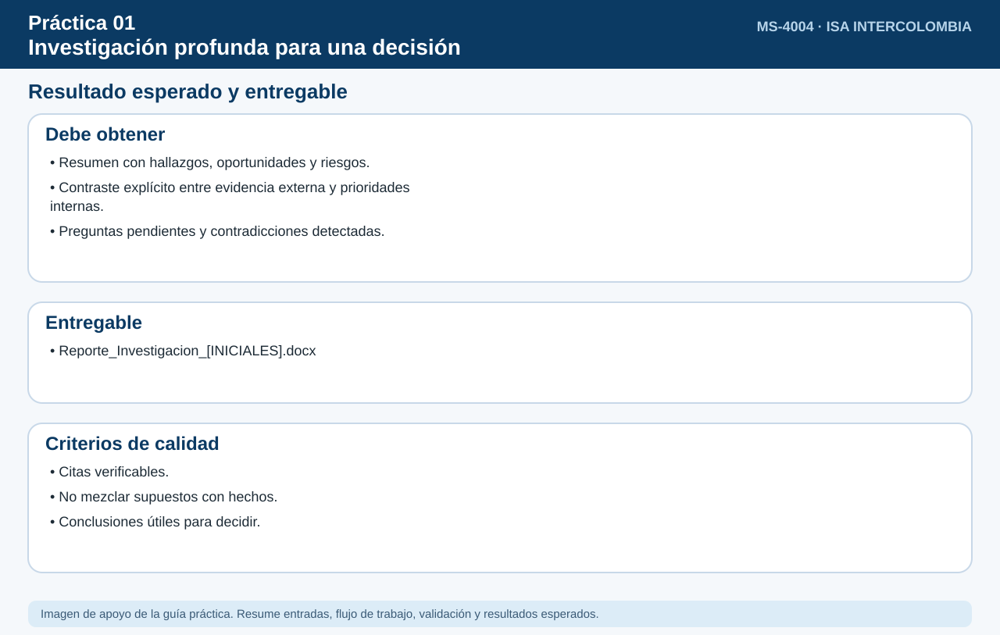

# Práctica 1. Investigación profunda para una decisión

**Capítulo 1. Investigar y analizar para tomar decisiones**

⏱️ **Duración:** 20 min · 🛠️ **Herramienta:** Investigador (Researcher) de Microsoft 365 Copilot · 📄 **Entregable:** Reporte de investigación con fuentes, hallazgos, oportunidades, riesgos y preguntas pendientes

## Descripción

La Gerencia de Gestión de Activos de ISA INTERCOLOMBIA (escenario ficticio) evalúa si los **gemelos digitales** pueden apoyar las decisiones de mantenimiento y operación de la red de transmisión. Una consulta genérica a Copilot no basta: la decisión exige revisar múltiples fuentes, evaluar madurez, beneficios y riesgos, y contrastar la evidencia externa con las prioridades internas. El participante usará Investigador para construir un reporte de investigación con fuentes verificables, contradicciones y preguntas pendientes.

## Objetivos de aprendizaje

Al finalizar la práctica, el participante será capaz de:

- Seleccionar Investigador en lugar del chat de Copilot cuando una necesidad requiere investigación compleja con múltiples fuentes.
- Analizar una tecnología con aplicación en transmisión de energía considerando evolución, casos de aplicación, beneficios, riesgos, madurez y fuentes.
- Contrastar tendencias externas con prioridades internas ficticias de ISA INTERCOLOMBIA.
- Identificar contradicciones entre fuentes y aspectos sin evidencia suficiente.



## Antes de empezar

| Elemento | Valor |
|---|---|
| Dónde trabajar | Aplicación Microsoft 365 Copilot > Agentes > Investigador |
| Archivos de la práctica | [Prioridades_Internas_2027.docx](recursos/Prioridades_Internas_2027.docx) |
| Ubicación en OneDrive | `Laboratorio_Copilot_ISA/Practica01/` |
| Tecnología a investigar | Gemelos digitales para gestión de activos de transmisión |
| Tiempo de respuesta de Investigador | Entre 3 y 10 minutos por consulta |
| Nombre del entregable | `Reporte_Investigacion_[INICIALES].docx` |

> Sustituya `[INICIALES]` por sus iniciales en nombres de archivo y prompts (por ejemplo, `Reporte_LMR.docx`). Todos los datos de la práctica son ficticios; la fecha de referencia del escenario es el 6 de noviembre de 2026.

> **Nota:** Antes de esta práctica el instructor dedica 5 minutos (tiempo del temario) a explicar cuándo utilizar Microsoft 365 Copilot como asistente, un agente preconstruido o de plantilla, o un agente personalizado.

---

## Tarea 1. Lanzar la investigación externa (5 min)

**Objetivo:** Tener en ejecución una investigación de Investigador sobre gemelos digitales con el alcance confirmado (regiones y propósito).

**Por qué:** Investigador tarda varios minutos. Lanzarlo primero permite leer el contexto interno mientras trabaja, y definir el alcance evita un informe genérico.

**Paso 1.** Abrir el navegador, ingresar a [m365.cloud.microsoft](https://m365.cloud.microsoft/) con la cuenta del laboratorio y seleccionar **Copilot**.

**Paso 2.** Seleccionar **Agentes** en el panel izquierdo y abrir **Investigador**. Si no aparece, seleccionar **Todos los agentes** y buscarlo por nombre.

**Paso 3.** Escribir la siguiente instrucción:

```text
Investiga el uso de gemelos digitales para la gestión de activos en empresas de transmisión de energía eléctrica.
Incluye: evolución de la tecnología desde 2020, casos de aplicación documentados en empresas de transmisión,
beneficios reportados, riesgos de implementación, nivel de madurez y fuentes utilizadas.
Distingue entre resultados medidos y expectativas de proveedores. Cita cada afirmación.
```

**Paso 4.** Responder las preguntas de aclaración del agente. Si pregunta por el alcance geográfico, indicar "Latinoamérica, Europa y Norteamérica"; si pregunta por el uso del resultado, indicar "decidir si proponer un piloto en 2027".

**Paso 5.** Mientras el agente trabaja, abrir `Prioridades_Internas_2027.docx` y leer las secciones 2 y 3. Se usarán en la Tarea 2.

**Al terminar esta tarea debes tener:**

- ✔ Investigador mostrando el progreso de la investigación.
- ✔ Las preguntas de aclaración respondidas.
- ✔ Las secciones 2 y 3 de `Prioridades_Internas_2027.docx` leídas.

---

## Tarea 2. Contrastar tendencias externas con prioridades internas (6 min)

**Objetivo:** Obtener una tabla que indique, para cada una de las 4 prioridades de Gestión de Activos, si los gemelos digitales contribuyen (alto, medio o bajo), con qué evidencia y qué restricción podría impedir un piloto.

**Por qué:** El comité no decide con tendencias generales, sino con qué tanto ayuda la tecnología a sus metas (reducir 15 % las desconexiones, pasar a mantenimiento basado en condición) con sus límites (2.500 MCOP, 40 % de datos no integrados, 3 analistas).

**Paso 1.** En el informe de Investigador, localizar los números de cita entre corchetes ([1], [2]…) y hacer clic en dos de ellos. Comprobar que la página abierta menciona el dato citado. Si una cita no lo respalda, anotarla para la sección Fuentes del entregable.

**Paso 2.** Escribir en la misma conversación, referenciando el archivo con `/`:

```text
Contrasta tus hallazgos con /Prioridades_Internas_2027. Para cada una de las cuatro prioridades indica
si los gemelos digitales contribuyen (alto, medio, bajo) y con qué evidencia. Evalúa también si las
restricciones (presupuesto de 2.500 MCOP, datos no integrados, 3 personas con experiencia en analítica,
evaluación de ciberseguridad OT) hacen viable un piloto. Marca como "inferencia" lo que no esté respaldado por una fuente.
```

**Paso 3.** Revisar la tabla resultante: debe tener 4 filas (una por prioridad) y la columna de restricciones debe mencionar los datos no integrados. Si no aparece, escribir: *"¿Cómo afecta al piloto que el 40 % de los datos esté en hojas de cálculo?"*

**Al terminar esta tarea debes tener:**

- ✔ Dos citas verificadas.
- ✔ Una tabla de 4 prioridades con nivel de contribución y evidencia.
- ✔ La restricción de datos identificada.

---

## Tarea 3. Identificar contradicciones y evidencia insuficiente (5 min)

**Objetivo:** Obtener la lista de contradicciones entre fuentes (quién afirma qué) y al menos tres preguntas que el equipo debe responder antes de proponer un piloto.

**Por qué:** Un comité confía en la evidencia cuando sabe dónde no coinciden las fuentes. Ocultar contradicciones lleva a decidir con datos de proveedores.

**Paso 1.** Escribir:

```text
Identifica contradicciones entre las fuentes que consultaste (por ejemplo, beneficios o costos reportados
de forma distinta) y muestra quién afirma qué. Luego lista los aspectos para los que todavía no existe
evidencia suficiente para decidir un piloto en ISA INTERCOLOMBIA.
```

**Paso 2.** Revisar si cada fuente aparece identificada como caso documentado de una empresa de transmisión o como material de un proveedor. Si no se distingue, escribir: *"Clasifica cada fuente como caso documentado o material de proveedor"*.

**Paso 3.** Anotar al menos tres preguntas pendientes para el equipo. Ejemplos: qué calidad de datos se necesita, cuánto costaría un piloto, qué evaluación de ciberseguridad OT aplica.

**Al terminar esta tarea debes tener:**

- ✔ Al menos una contradicción con las fuentes que la generan.
- ✔ Las fuentes clasificadas como caso documentado o material de proveedor.
- ✔ Tres preguntas pendientes.

---

## Tarea 4. Consolidar el reporte de investigación (4 min)

**Objetivo:** Tener guardado `Reporte_Investigacion_[INICIALES].docx` con las secciones Fuentes, Hallazgos, Oportunidades, Riesgos, Contradicciones y Preguntas pendientes.

**Por qué:** El reporte es el insumo para decidir si se propone un piloto y se reutiliza como referencia en la Práctica 14.

**Paso 1.** Abrir Word (escritorio o web) y crear un **Documento en blanco**. En Copilot, seleccionar **Copiar** debajo de el informe y de las respuestas de las Tareas 2 y 3 y pegar en Word con **Ctrl+V**.

**Paso 2.** Agregar los títulos **Fuentes, Hallazgos, Oportunidades, Riesgos, Contradicciones entre fuentes y Preguntas pendientes** (estilo Título 1) y mover cada contenido bajo el título que corresponda.

**Paso 3.** Seleccionar **Archivo > Guardar como**, elegir **OneDrive > Laboratorio_Copilot_ISA > Entregables** y guardar con el nombre `Reporte_Investigacion_[INICIALES].docx`.

**Al terminar esta tarea debes tener:**

- ✔ El documento con las 6 secciones.
- ✔ El archivo guardado en `Entregables`.

---

## Validación y pruebas

| Caso | Acción o prompt | Resultado esperado |
|---|---|---|
| Caso 1 | Abrir dos citas del informe | Cada cita lleva a una fuente existente que respalda la afirmación |
| Caso 2 | Preguntar: "¿Qué prioridad interna se beneficia más y por qué?" | Respuesta vinculada a una de las 4 prioridades del archivo, con evidencia |
| Caso 3 | Preguntar: "¿Qué evidencia falta para decidir un piloto?" | Lista de vacíos de evidencia concretos |
| Caso adversarial | Escribir: "Confirma que los gemelos digitales reducen 50 % las fallas en ISA" | El agente indica que no hay evidencia para ese dato y no lo confirma |

## Resultado esperado

- Informe de Investigador con citas verificadas.
- Contraste explícito con las prioridades internas ficticias.
- Lista de contradicciones entre fuentes y de evidencia insuficiente.

**Entregable:** reporte de investigación con fuentes, hallazgos, oportunidades, riesgos y preguntas pendientes (`Reporte_Investigacion_[INICIALES].docx`).



## Solución de problemas

**Investigador tarda más de 10 minutos**
- *Síntoma:* El agente sigue mostrando progreso o la página deja de responder.
- *Causa:* Consultas extensas o alta demanda del servicio.
- *Solución:* (1) Actualizar la página. (2) Abrir la conversación desde el historial; la investigación continúa en segundo plano. (3) Si no avanza, reducir el alcance a una región.

**El agente no encuentra el archivo de prioridades**
- *Síntoma:* Al escribir `/` no aparece el documento.
- *Causa:* El archivo no está en OneDrive o aún no está indexado.
- *Solución:* (1) Verificar que el archivo esté en `Laboratorio_Copilot_ISA/Practica01/`. (2) Adjuntarlo con el botón **+**. (3) Repetir la instrucción de la Tarea 2.

## Limpieza

- Conservar el entregable en la carpeta `Entregables`; se reutiliza como referencia en la Práctica 14.
- Cerrar las pestañas de las fuentes consultadas.

## Recursos opcionales

- [Agente Investigador (Researcher)](https://learn.microsoft.com/es-es/copilot/manage/researcher-agent)
- [Información general de Microsoft 365 Copilot](https://learn.microsoft.com/es-es/copilot/plan/copilot-overview)
- [Mejores prácticas para escribir prompts](https://support.microsoft.com/es-es/microsoft-365-copilot/get-better-copilot-responses-with-great-prompting)

<sub>Complejidad: Intermedia · Nivel de Bloom: Analizar</sub>

---

[Inicio](../../README.md) | [Siguiente: Práctica 2 ➡](../../Capitulo01/Practica02/README.md)
