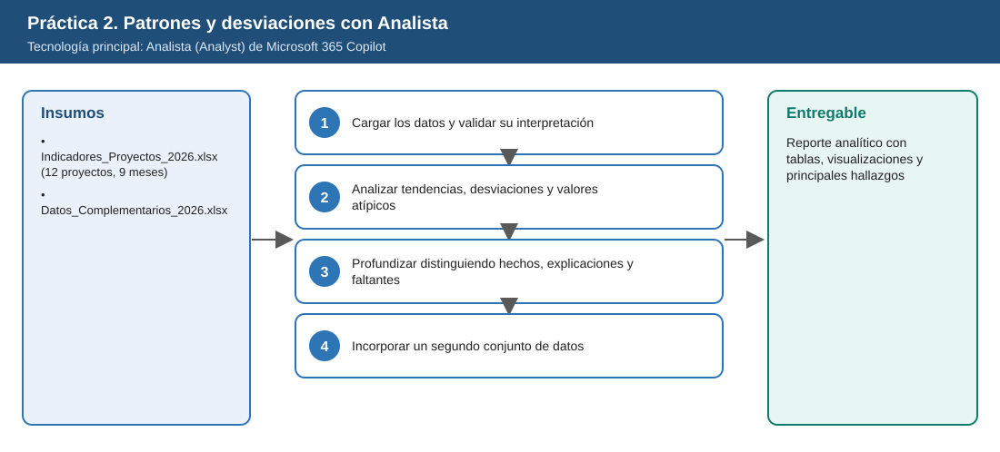
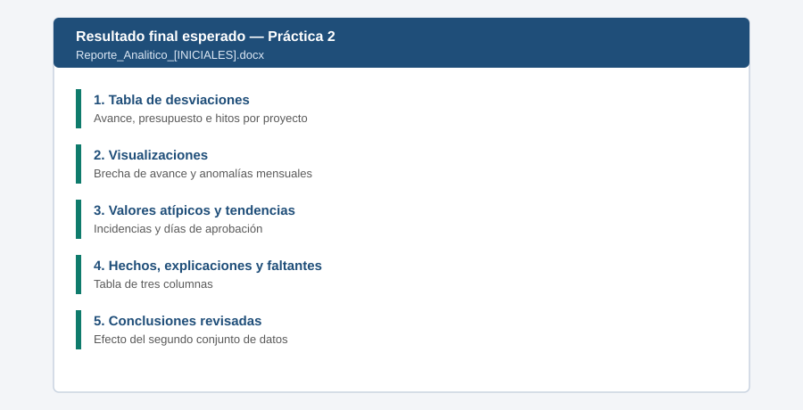

# Práctica 2. Encontrar patrones y desviaciones con Analista

## Objetivo de la práctica:

Al finalizar la práctica, serás capaz de:

- Utilizar Analista para analizar un archivo de Excel con indicadores de proyectos.
- Identificar tendencias, desviaciones, valores atípicos y relaciones entre indicadores.
- Distinguir datos observados, posibles explicaciones e información faltante para confirmar causas.
- Evaluar si un segundo conjunto de datos fortalece o modifica las conclusiones iniciales.



## Duración aproximada:

- 17 minutos.

## Tabla de ayuda:

| Elemento | Valor |
|---|---|
| Dónde trabajar | Aplicación Microsoft 365 Copilot > Agentes > Analista |
| Archivos de la práctica | [Indicadores_Proyectos_2026.xlsx](recursos/Indicadores_Proyectos_2026.xlsx)<br>[Datos_Complementarios_2026.xlsx](recursos/Datos_Complementarios_2026.xlsx) |
| Periodo de los datos | Enero a septiembre de 2026 |
| Unidad monetaria | Millones de pesos colombianos (MCOP) |

## Instrucciones

El área de Proyectos de ISA INTERCOLOMBIA (caso del curso) consolida cada mes los indicadores de 12 proyectos: avance, presupuesto, hitos, incidencias y tiempos de aprobación. El participante usará Analista para encontrar tendencias, desviaciones, valores atípicos y relaciones entre indicadores, distinguir datos observados de posibles explicaciones y comprobar si un segundo conjunto de datos fortalece o modifica sus conclusiones.

### Tarea 1. Cargar los datos y validar su interpretación (3 min)

**Paso 1.** Abrir **Microsoft Edge**, ingresar a [m365.cloud.microsoft](https://m365.cloud.microsoft/) e iniciar sesión con su cuenta corporativa si se solicita.

- **Alternativa:** Si no aparece el chat, seleccionar el icono **Copilot** en la barra lateral izquierda.

**Paso 2.** Seleccionar en el panel izquierdo **Agentes**, escribir `Analista` en la búsqueda y abrir el agente (en inglés: **Analyst**).

- **Comprobación:** el nombre **Analista** encima del cuadro de mensaje.
- **Si no aparece:** buscarlo en **Todos los agentes**; si no aparece, solicitar apoyo a quien administra el entorno.

**Paso 3.** Seleccionar el botón **+** (Agregar) junto al cuadro de mensaje > **Cargar desde OneDrive** (o **Archivos**) > `Laboratorio_Copilot_ISA > Practica02` y elegir `Indicadores_Proyectos_2026.xlsx`.

- **Comprobación:** el archivo como una tarjeta adjunta encima del cuadro de mensaje.
- **Si no aparece:** escribir `/Indicadores` en el cuadro de mensaje y seleccionarlo de la lista.

**Paso 4.** Pegar el siguiente prompt y enviarlo:

```text
Describe la estructura del archivo: hojas, columnas, periodo y número de proyectos.
Usa la hoja Diccionario para explicar cada indicador. No hagas análisis todavía.
```

- **Comprobación:** Analista muestra que está ejecutando código (por ejemplo, "Analizando…" o un bloque de código desplegable) y luego describe las hojas `Indicadores_Mensuales` y `Diccionario`.

**Paso 5.** Comprobar en la respuesta que el agente reporta **12 proyectos** (PRY-01 a PRY-12) y **9 meses** (2026-01 a 2026-09), y que explica `Ejecutado_acum_MCOP` como valor acumulado en millones de pesos.

- **Si no aparece:** escribir: *"Muestra el conteo de proyectos únicos y de meses"* y corregir la interpretación antes de continuar.

### Tarea 2. Analizar tendencias, desviaciones y valores atípicos (6 min)

**Paso 1.** Pegar el siguiente prompt en la misma conversación:

```text
Con los datos al cierre de 2026-09, calcula para cada proyecto la brecha de avance (real - planeado),
la relación ejecutado/planeado del presupuesto y los hitos pendientes. Muestra una tabla con los
5 proyectos más desviados y un gráfico de barras de la brecha de avance.
```

- **Comprobación:** una tabla con los 5 proyectos más desviados y un gráfico de barras. Puede tardar entre 1 y 3 minutos.

**Paso 2.** Revisar la tabla: deben aparecer **PRY-07** y **PRY-09** con -13 puntos de brecha de avance y **PRY-03** con una relación ejecutado/planeado cercana a **1,27**.

- **Si no aparece:** escribir: *"Muestra cómo calculaste la brecha de avance para PRY-07"* y comparar con el archivo.

**Paso 3.** Pegar el siguiente prompt:

```text
Identifica valores atípicos en incidencias mensuales y tendencias en los días de ciclo de aprobación.
Muestra un gráfico de líneas por mes para los proyectos con comportamiento anómalo.
```

- **Comprobación:** un análisis de valores atípicos y un gráfico de líneas. Debe destacar el pico de **14 incidencias** de PRY-07 en **2026-06** y los días de aprobación de **PRY-10**, que crecen de **9 a 33**.

**Paso 4.** Abrir un **Documento en blanco** de Word en otra pestaña. En Analista, pasar el puntero sobre cada gráfico y seleccionar el icono de descarga (o clic derecho > **Copiar imagen**) y pegarlo en el documento. Copiar también la tabla de los 5 proyectos.

- **Comprobación:** dos gráficos y una tabla en el documento, que será su entregable.

### Tarea 3. Profundizar distinguiendo hechos, explicaciones y faltantes (4 min)

**Paso 1.** Pegar el siguiente prompt:

```text
Para los tres hallazgos más relevantes, separa la respuesta en tres columnas:
"Dato observado", "Posible explicación" e "Información faltante para confirmar la causa".
No presentes una explicación como hecho.
```

- **Comprobación:** una tabla con tres columnas: Dato observado, Posible explicación e Información faltante para confirmar la causa.

**Paso 2.** Leer la columna **Posible explicación**: cada frase debe estar redactada como hipótesis (por ejemplo, *"podría deberse a…"*) y no como hecho (*"se debe a…"*).

- **Si no aparece:** escribir: *"Reclasifica como hipótesis la explicación de [proyecto]"*.

**Paso 3.** Copiar la tabla y pegarla en el documento de Word debajo de los gráficos.

### Tarea 4. Incorporar un segundo conjunto de datos (4 min)

**Paso 1.** Adjuntar en Analista el segundo archivo con el botón **+** > `Laboratorio_Copilot_ISA > Practica02 > Datos_Complementarios_2026.xlsx`.

- **Comprobación:** dos archivos disponibles en la conversación.

**Paso 2.** Pegar el siguiente prompt:

```text
Cruza este segundo archivo con el análisis anterior por proyecto y mes. Para cada conclusión inicial indica si
se fortalece, se modifica o se descarta, y por qué.
```

- **Comprobación:** cada conclusión anterior marcada como fortalecida, modificada o descartada, con su razón.

**Paso 3.** Comprobar dos cambios clave: el pico de PRY-07 debe relacionarse con el **cambio de contratista** de junio, y la sobreejecución de PRY-03 con el **cambio de alcance aprobado** en abril sin actualizar la línea base.

- **Si no aparece:** preguntar: *"¿Qué dice la hoja Nota_cambios_alcance sobre PRY-03 y PRY-07?"*

**Paso 4.** Copiar la respuesta y pegarla al final del documento de Word bajo el título **Conclusiones revisadas**.

**Paso 5.** Guardar el archivo en **OneDrive > Laboratorio_Copilot_ISA > Entregables** con el nombre `Reporte_Analitico_[INICIALES].docx`: en Word de escritorio, **Archivo > Guardar como**; en Word para la web, hacer clic en el nombre del documento en la parte superior y elegir la carpeta.

### Resultado esperado




- Tablas y al menos dos visualizaciones generadas por Analista.
- Hallazgos clasificados en dato observado, explicación e información faltante.
- Conclusiones revisadas tras el segundo conjunto de datos.

**Entregable:** reporte analítico con tablas, visualizaciones y principales hallazgos (`Reporte_Analitico_[INICIALES].docx`).
