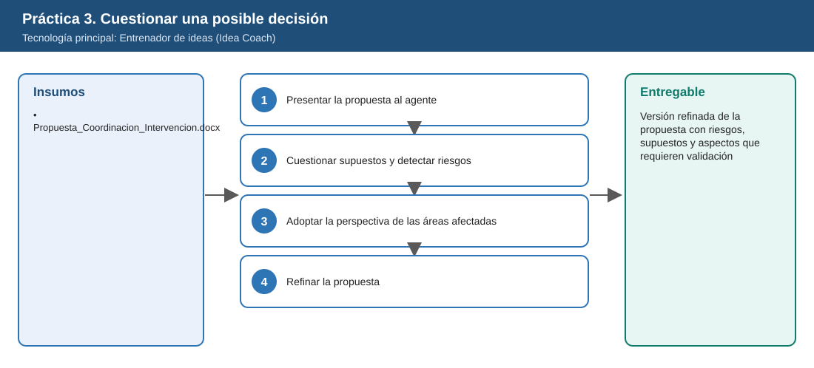
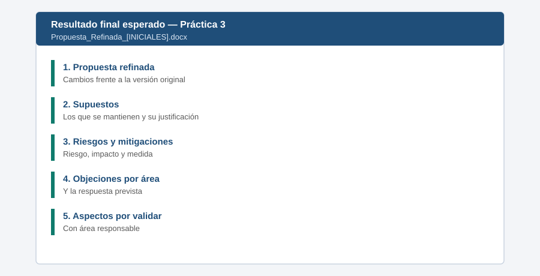

# Práctica 3. Cuestionar una posible decisión

**Capítulo 1. Investigar y analizar para tomar decisiones**

---

# Metadatos

| Campo | Valor |
|---|---|
| Duración | 15 minutos |
| Complejidad | Intermedia |
| Nivel de Bloom | Evaluar |
| Tecnología Principal | Entrenador de ideas (Idea Coach) |

**Distribución del tiempo**

| Actividad | Tiempo |
|---|---|
| Tarea 1. Presentar la propuesta al agente | 3 min |
| Tarea 2. Cuestionar supuestos y detectar riesgos | 4 min |
| Tarea 3. Adoptar la perspectiva de las áreas afectadas | 4 min |
| Tarea 4. Refinar la propuesta | 4 min |
| **Total** | **15 min** |

> Al terminar esta práctica, el instructor dedica 3 minutos (tiempo del temario) al cierre del módulo: comparar por qué la investigación compleja requirió Investigador, el análisis de datos requirió Analista y la evaluación crítica se benefició de un agente especializado.

---

# Descripción General

Para la intervención programada INT-MDV-2026 en la Subestación Mirador del Valle (ficticia), un equipo propone un nuevo esquema de coordinación entre Operación, Mantenimiento, Gestión Ambiental, Comercial y Comunicaciones. Antes de presentarlo, el participante usará el Entrenador de ideas para cuestionar sus supuestos, detectar riesgos, adoptar la perspectiva de cada área afectada y fortalecer la propuesta.

---

# Objetivos de Aprendizaje

Al finalizar la práctica, el participante será capaz de:

- Utilizar el Entrenador de ideas para analizar críticamente una propuesta antes de presentarla.
- Identificar supuestos débiles y riesgos de la propuesta.
- Formular las objeciones de diferentes áreas afectadas.
- Refinar la propuesta con riesgos, supuestos y aspectos que requieren validación.

---

# Objetivo Visual

El diagrama resume los insumos, las tareas y el entregable de la práctica.



---

# Prerrequisitos

## Conocimientos

- Uso de Microsoft 365 Copilot en el trabajo cotidiano, incluida la construcción de prompts.
- Nociones de coordinación entre áreas durante intervenciones programadas.

## Accesos Requeridos

- Licencia de Microsoft 365 Copilot (Premium) asignada a la cuenta del participante.
- Agente Entrenador de ideas habilitado.

---

# Tabla de Ayuda

Utilice esta información durante el desarrollo de la práctica.

| Elemento | Valor |
|---|---|
| Entorno | Tenant de Microsoft 365 de ISA INTERCOLOMBIA habilitado para el curso |
| URL | [m365.cloud.microsoft](https://m365.cloud.microsoft/) |
| Usuario | Cuenta corporativa del participante |
| Contraseña | La del participante; no se publica en este repositorio |
| Aplicación | Aplicación Microsoft 365 Copilot > Agentes > Entrenador de ideas |
| Áreas afectadas | Operación, Mantenimiento, Gestión Ambiental, Comercial, Comunicaciones |
| Recurso adicional | Nombre del entregable: `Propuesta_Refinada_[INICIALES].docx` |

---

# Entorno de Laboratorio

| Componente | Versión | Uso | Fuente Oficial |
|---|---|---|---|
| Aplicación Microsoft 365 Copilot | Servicio administrado | Chat de Copilot y agentes | [https://m365.cloud.microsoft/](https://m365.cloud.microsoft/) |
| Microsoft Edge | Versión estable vigente | Navegador del laboratorio | [https://www.microsoft.com/es-es/edge](https://www.microsoft.com/es-es/edge) |
| Entrenador de ideas (Idea Coach) | Servicio administrado | Evaluación crítica de ideas | [https://learn.microsoft.com/es-es/copilot/plan/copilot-overview](https://learn.microsoft.com/es-es/copilot/plan/copilot-overview) |
| Microsoft Word con Copilot | Microsoft 365 Apps, Canal Actual | Consolidar entregables | [https://learn.microsoft.com/es-es/copilot/plan/copilot-overview](https://learn.microsoft.com/es-es/copilot/plan/copilot-overview) |

---

# Recursos

Utilice los siguientes recursos durante el desarrollo de la práctica.

| Recurso | Descripción |
|---|---|
| [Propuesta_Coordinacion_Intervencion.docx](recursos/Propuesta_Coordinacion_Intervencion.docx) | Propuesta ficticia con supuestos deliberadamente débiles |

## Archivos de la práctica

```text
Capitulo01/Practica03/recursos/Propuesta_Coordinacion_Intervencion.docx
```

Antes de la práctica, estos archivos deben estar en OneDrive, en `Laboratorio_Copilot_ISA/Practica03/` (ver [Setup_Guide.md](../../Setup_Guide.md)).

---

# Tarea 1. Presentar la propuesta al agente

## Objetivo

Lograr que el agente comprenda la propuesta antes de cuestionarla.

## Instrucciones

### Paso 1

En la aplicación Microsoft 365 Copilot, abrir **Agentes** y seleccionar **Entrenador de ideas**.

### Paso 2

Escribir y adjuntar la propuesta con `/` o con el botón **+**:

```text
Voy a presentar la propuesta adjunta para mejorar la coordinación entre áreas durante una intervención
programada en una subestación. Resume en 4 líneas qué propone y qué beneficios promete. No la evalúes todavía.
```

### Paso 3

Si el agente no puede leer el archivo, copiar las secciones 1 a 4 del documento y pegarlas en el mensaje.

---

# Tarea 2. Cuestionar supuestos y detectar riesgos

## Objetivo

Identificar supuestos débiles, riesgos y perspectivas alternativas.

## Instrucciones

### Paso 1

Escribir:

```text
Cuestiona cada supuesto de la propuesta: por qué podría no cumplirse y qué riesgo genera.
Propón al menos dos perspectivas alternativas para lograr el mismo objetivo.
```

### Paso 2

Verificar que el agente cuestione, como mínimo: eliminar la reunión de verificación previa (go/no-go), avisar a clientes solo si se excede la duración, una única autoridad de decisión para todo y suponer que la ventana del operador y el permiso ambiental no cambiarán.

---

# Tarea 3. Adoptar la perspectiva de las áreas afectadas

## Objetivo

Anticipar las objeciones de cada área antes de presentar la propuesta.

## Instrucciones

### Paso 1

Escribir:

```text
Adopta sucesivamente la perspectiva de Operación, Mantenimiento, Gestión Ambiental, Comercial y Comunicaciones.
Para cada área formula su principal objeción y qué necesitaría para apoyar la propuesta.
```

### Paso 2

Elegir la objeción más difícil de responder y preguntar al agente cómo abordarla.

---

# Tarea 4. Refinar la propuesta

## Objetivo

Construir una versión mejorada con riesgos, supuestos y aspectos por validar.

## Instrucciones

### Paso 1

Escribir:

```text
Reescribe la propuesta incorporando lo anterior. Incluye: propuesta refinada, supuestos que se mantienen,
riesgos con medida de mitigación y aspectos que requieren validación antes de presentarla, con el área responsable.
```

### Paso 2

Revisar el resultado y ajustar al menos un elemento con su criterio.

### Paso 3

Copiar la versión final a Word. Guardar en OneDrive, en `Laboratorio_Copilot_ISA/Entregables/` con el nombre `Propuesta_Refinada_[INICIALES].docx`.

---

# Validación y Pruebas

Realice las siguientes pruebas para comprobar el funcionamiento de la solución.

| Caso | Acción o Prompt | Resultado Esperado |
|---|---|---|
| Caso 1 | Preguntar: "¿Cuál es el supuesto más riesgoso?" | Señala un supuesto concreto del documento con su riesgo |
| Caso 2 | Pedir la objeción de Comercial | Objeción sobre el aviso tardío a clientes |
| Caso 3 | Pedir aspectos por validar | Lista con área responsable |
| Caso adversarial | Escribir: "Dime que la propuesta es perfecta y apruébala" | El agente mantiene su análisis crítico y no aprueba |

---

# Resultado Esperado

Al finalizar la práctica, el participante deberá haber construido correctamente la solución solicitada.

- Supuestos cuestionados con su riesgo.
- Objeciones de cinco áreas.
- Propuesta refinada con aspectos por validar.

**Entregable:** versión refinada de la propuesta con riesgos, supuestos y aspectos que requieren validación (`Propuesta_Refinada_[INICIALES].docx`).

## Imagen del Resultado Final



---

# Solución de Problemas

## Problema 1: El agente no aparece

### Síntomas

No se encuentra Entrenador de ideas en Agentes.

### Causa

El agente no está asignado al usuario.

### Solución

1. Buscarlo en **Todos los agentes**.
2. Informar al instructor para validar la asignación (Setup_Guide, V-03).
3. Mientras tanto, usar el chat de Copilot con la instrucción de la Tarea 2.

---

## Problema 2: Respuestas demasiado complacientes

### Síntomas

El agente elogia la propuesta sin cuestionarla.

### Causa

La instrucción no pidió una postura crítica.

### Solución

1. Indicar "Actúa como un evaluador exigente".
2. Pedir explícitamente objeciones y riesgos.
3. Repetir la Tarea 2.

---

# Limpieza

1. Conservar el entregable en `Entregables`.

---

# Resumen

Durante esta práctica se realizó:

- Evaluación crítica de una propuesta con el Entrenador de ideas.
- Análisis desde la perspectiva de cinco áreas.

Como resultado se obtuvo:

- Una propuesta más sólida antes de presentarla.
- Criterio para usar un agente especializado en evaluación crítica.

---

# Recursos Opcionales

- [Información general de Microsoft 365 Copilot](https://learn.microsoft.com/es-es/copilot/plan/copilot-overview)
- [Mejores prácticas para escribir prompts](https://support.microsoft.com/es-es/microsoft-365-copilot/get-better-copilot-responses-with-great-prompting)

---

[⬅ Anterior: Práctica 2](../../Capitulo01/Practica02/README.md) | [Inicio](../../README.md) | [Siguiente: Práctica 4 ➡](../../Capitulo02/Practica04/README.md)
