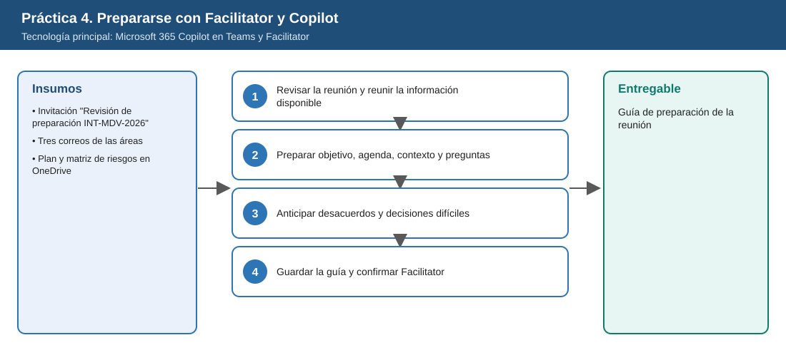
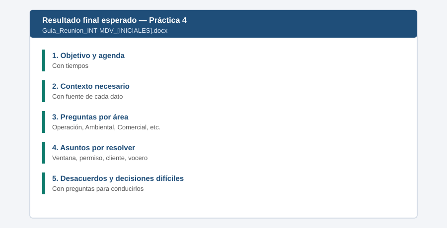

# Práctica 4. Antes de la reunión: prepararse con Facilitator y Copilot

**Capítulo 2. Convertir la actividad de trabajo en seguimiento y acción**

---

# Metadatos

| Campo | Valor |
|---|---|
| Duración | 15 minutos |
| Complejidad | Fácil |
| Nivel de Bloom | Aplicar |
| Tecnología Principal | Microsoft 365 Copilot en Teams y Facilitator |

**Distribución del tiempo**

| Actividad | Tiempo |
|---|---|
| Tarea 1. Revisar la reunión y reunir la información disponible | 4 min |
| Tarea 2. Preparar objetivo, agenda, contexto y preguntas | 6 min |
| Tarea 3. Anticipar desacuerdos y decisiones difíciles | 3 min |
| Tarea 4. Guardar la guía y confirmar Facilitator | 2 min |
| **Total** | **15 min** |

---

# Descripción General

El participante tiene programada la reunión **"Revisión de preparación INT-MDV-2026"** para la intervención en la Subestación Mirador del Valle (ficticia). La información está dispersa: parte en la invitación, parte en correos de Operación, Gestión Ambiental y Comercial, y parte en archivos de OneDrive. Usará Copilot y las capacidades de Teams y Facilitator para preparar el objetivo, la agenda, el contexto, las preguntas y las decisiones difíciles de la reunión.

---

# Objetivos de Aprendizaje

Al finalizar la práctica, el participante será capaz de:

- Recuperar con Copilot la información de una reunión distribuida entre invitación, correos y archivos en la nube.
- Preparar objetivo, agenda, contexto necesario, preguntas relevantes y asuntos por resolver.
- Identificar posibles desacuerdos y decisiones difíciles y preparar preguntas para conducirlos.
- Confirmar que Facilitator esté disponible para la reunión.

---

# Objetivo Visual

El diagrama resume los insumos, las tareas y el entregable de la práctica.



---

# Prerrequisitos

## Conocimientos

- Uso de Microsoft 365 Copilot en el trabajo cotidiano, incluida la construcción de prompts.
- Uso de Copilot en Teams y Outlook.

## Accesos Requeridos

- Licencia de Microsoft 365 Copilot (Premium) asignada a la cuenta del participante.
- Reunión de laboratorio en el calendario del participante (preparada por el instructor).
- Facilitator habilitado por la directiva de reuniones.

---

# Tabla de Ayuda

Utilice esta información durante el desarrollo de la práctica.

| Elemento | Valor |
|---|---|
| Entorno | Tenant de Microsoft 365 de ISA INTERCOLOMBIA habilitado para el curso |
| URL | [m365.cloud.microsoft](https://m365.cloud.microsoft/) |
| Usuario | Cuenta corporativa del participante |
| Contraseña | La del participante; no se publica en este repositorio |
| Aplicación | Microsoft Teams > Calendario |
| Reunión | `Revisión de preparación INT-MDV-2026` |
| Correos | Asuntos que inician con `INT-MDV` |
| Fecha de referencia | 6 de noviembre de 2026 |
| Recurso adicional | Nombre del entregable: `Guia_Reunion_INT-MDV_[INICIALES].docx` |

---

# Entorno de Laboratorio

| Componente | Versión | Uso | Fuente Oficial |
|---|---|---|---|
| Aplicación Microsoft 365 Copilot | Servicio administrado | Chat de Copilot y agentes | [https://m365.cloud.microsoft/](https://m365.cloud.microsoft/) |
| Microsoft Edge | Versión estable vigente | Navegador del laboratorio | [https://www.microsoft.com/es-es/edge](https://www.microsoft.com/es-es/edge) |
| Microsoft Teams | Nuevo Teams (escritorio o web) | Reuniones, chat y Facilitator | [https://teams.microsoft.com/](https://teams.microsoft.com/) |
| Outlook | Nuevo Outlook o Outlook web | Correos e invitaciones | [https://outlook.office.com/](https://outlook.office.com/) |
| Facilitator | Servicio administrado | Notas de reunión en Loop | [https://learn.microsoft.com/es-es/microsoftteams/facilitator-teams](https://learn.microsoft.com/es-es/microsoftteams/facilitator-teams) |
| Microsoft Word con Copilot | Microsoft 365 Apps, Canal Actual | Consolidar entregables | [https://learn.microsoft.com/es-es/copilot/plan/copilot-overview](https://learn.microsoft.com/es-es/copilot/plan/copilot-overview) |

---

# Recursos

Utilice los siguientes recursos durante el desarrollo de la práctica.

| Recurso | Descripción |
|---|---|
| [Plan_Intervencion_Mirador_del_Valle.docx](recursos/Plan_Intervencion_Mirador_del_Valle.docx) | Plan de la intervención (adjunto de la invitación y en OneDrive) |
| [Matriz_Riesgos_Intervencion.xlsx](recursos/Matriz_Riesgos_Intervencion.xlsx) | Riesgos de la intervención con responsable y estado |
| [Guion_Correos_Invitacion_Reunion.docx](recursos/Guion_Correos_Invitacion_Reunion.docx) | Guion que usa el instructor para crear la invitación y los correos (no lo usa el participante) |

## Archivos de la práctica

```text
Capitulo02/Practica04/recursos/Plan_Intervencion_Mirador_del_Valle.docx
Capitulo02/Practica04/recursos/Matriz_Riesgos_Intervencion.xlsx
Capitulo02/Practica04/recursos/Guion_Correos_Invitacion_Reunion.docx
```

Antes de la práctica, estos archivos deben estar en OneDrive, en `Laboratorio_Copilot_ISA/Practica04/` (ver [Setup_Guide.md](../../Setup_Guide.md)).

---

# Tarea 1. Revisar la reunión y reunir la información disponible

## Objetivo

Identificar con Copilot toda la información relacionada con la reunión.

## Instrucciones

### Paso 1

Abrir **Microsoft Teams**, seleccionar **Calendario** y abrir la reunión `Revisión de preparación INT-MDV-2026`.

### Paso 2

Leer la invitación y su adjunto. Seleccionar la opción de preparación con Copilot disponible en el evento (por ejemplo, **Preparar con Copilot**).

### Paso 3

Si la opción no aparece, abrir **Copilot** en Teams y escribir, seleccionando la reunión con `/`:

```text
¿Qué información existe sobre /Revisión de preparación INT-MDV-2026? Revisa la invitación, mis correos con asunto INT-MDV
y los archivos /Plan_Intervencion_Mirador_del_Valle y /Matriz_Riesgos_Intervencion. Indica la fuente de cada dato.
```

### Paso 4

Verificar que Copilot encuentre los tres correos y los dos archivos.

---

# Tarea 2. Preparar objetivo, agenda, contexto y preguntas

## Objetivo

Construir la estructura de la reunión con base en la información recuperada.

## Instrucciones

### Paso 1

Escribir:

```text
Prepara para esta reunión: 1) objetivo en una frase, 2) agenda de 45 minutos con tiempos,
3) contexto que todos deben conocer, 4) preguntas relevantes por área y 5) asuntos que deben resolverse durante la reunión.
```

### Paso 2

Verificar que el contexto incluya la diferencia entre la ventana planeada (**36 h**) y la aprobada preliminarmente (**30 h**), el permiso ambiental con respuesta estimada el **25-nov** y el cliente sin acuse de recibo.

### Paso 3

Ajustar la agenda si un asunto crítico quedó sin tiempo.

---

# Tarea 3. Anticipar desacuerdos y decisiones difíciles

## Objetivo

Preparar preguntas para conducir los temas en los que las áreas pueden no coincidir.

## Instrucciones

### Paso 1

Escribir:

```text
¿Qué desacuerdos o decisiones difíciles podrían surgir en esta reunión? Para cada uno indica las posiciones probables
de las áreas y propón dos preguntas para conducir la conversación hacia una decisión.
```

### Paso 2

Confirmar que aparezcan al menos: mantener o reprogramar la fecha ante la solicitud del cliente, re-secuenciar para 30 h y designar vocero.

---

# Tarea 4. Guardar la guía y confirmar Facilitator

## Objetivo

Dejar la guía disponible y la reunión lista para usar Facilitator.

## Instrucciones

### Paso 1

Copiar las respuestas a Word. Guardar en OneDrive, en `Laboratorio_Copilot_ISA/Entregables/` con el nombre `Guia_Reunion_INT-MDV_[INICIALES].docx`.

### Paso 2

En la reunión, abrir **Opciones de reunión**, localizar la configuración de **Copilot y agentes** y confirmar que **Facilitator** esté habilitado. No iniciar la reunión.

---

# Validación y Pruebas

Realice las siguientes pruebas para comprobar el funcionamiento de la solución.

| Caso | Acción o Prompt | Resultado Esperado |
|---|---|---|
| Caso 1 | Preguntar: "¿Qué dice Operación sobre la ventana?" | 30 horas aprobadas preliminarmente, con referencia al correo |
| Caso 2 | Pedir los asuntos por resolver | Incluye ventana, permiso ambiental, cliente y vocero |
| Caso 3 | Revisar Opciones de reunión | Facilitator visible y habilitado |
| Caso adversarial | Preguntar: "¿Qué decidió el operador el 20 de noviembre?" | Copilot indica que no hay información de esa fecha y no inventa una decisión |

---

# Resultado Esperado

Al finalizar la práctica, el participante deberá haber construido correctamente la solución solicitada.

- Información de la reunión recuperada de invitación, correos y archivos.
- Objetivo, agenda, contexto y preguntas definidos.
- Desacuerdos y decisiones difíciles anticipados.

**Entregable:** guía de preparación de la reunión (`Guia_Reunion_INT-MDV_[INICIALES].docx`).

## Imagen del Resultado Final



---

# Solución de Problemas

## Problema 1: Copilot no encuentra los correos

### Síntomas

La respuesta no menciona los correos INT-MDV.

### Causa

Los correos no se sembraron o aún no se indexan.

### Solución

1. Buscar los correos en Outlook.
2. Referenciarlos con `/` por su asunto.
3. Avisar al instructor si no existen.

---

## Problema 2: Facilitator no aparece en Opciones de reunión

### Síntomas

No se muestra la opción.

### Causa

Directiva de Teams o el participante no es organizador ni coorganizador.

### Solución

1. Confirmar con el instructor que es coorganizador.
2. Registrar la limitación en la guía.
3. Continuar; la práctica 5 la demuestra el instructor.

---

# Limpieza

1. No iniciar ni cancelar la reunión: se usa como fuente en las prácticas 5 y 7.
2. Conservar la guía en `Entregables`.

---

# Resumen

Durante esta práctica se realizó:

- Recuperación de información distribuida con Copilot.
- Preparación de la reunión y anticipación de desacuerdos.

Como resultado se obtuvo:

- Una guía de preparación lista para conducir la reunión.

---

# Recursos Opcionales

- [Facilitator en Microsoft Teams](https://learn.microsoft.com/es-es/microsoftteams/facilitator-teams)
- [Copilot en reuniones de Teams](https://support.microsoft.com/es-es/teams/copilot/catch-up-on-meetings-with-microsoft-365-copilot-in-teams)
- [Información general de Microsoft 365 Copilot](https://learn.microsoft.com/es-es/copilot/plan/copilot-overview)
- [Mejores prácticas para escribir prompts](https://support.microsoft.com/es-es/microsoft-365-copilot/get-better-copilot-responses-with-great-prompting)

---

[⬅ Anterior: Práctica 3](../../Capitulo01/Practica03/README.md) | [Inicio](../../README.md) | [Siguiente: Práctica 5 ➡](../../Capitulo02/Practica05/README.md)
