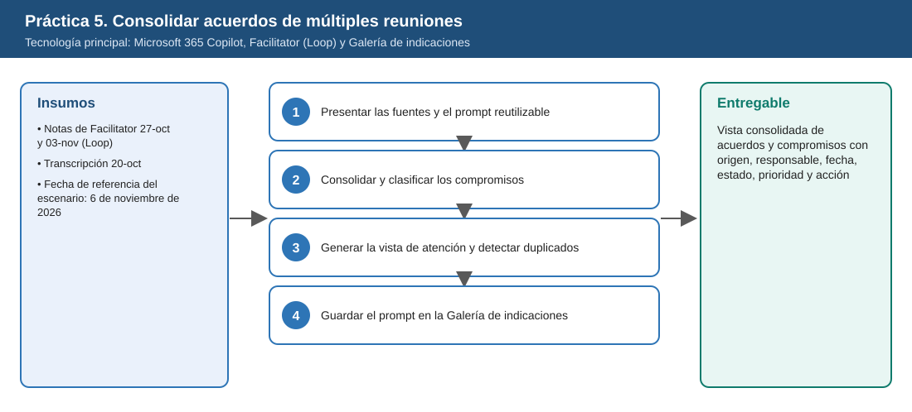
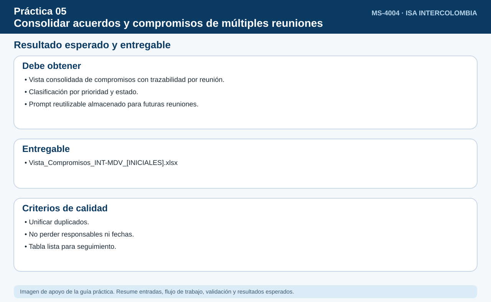

# Práctica 5. Consolidar acuerdos y compromisos de múltiples reuniones

**Capítulo 2. Convertir la actividad de trabajo en seguimiento y acción**

⏱️ **Duración:** 15 min · 🛠️ **Herramienta:** Microsoft 365 Copilot, Facilitator (Loop) y Galería de indicaciones · 📄 **Entregable:** Vista consolidada de acuerdos y compromisos con origen, responsable, fecha, estado, prioridad y acción

## Descripción

Durante la planeación de INT-MDV-2026 se realizaron tres reuniones (20-oct, 27-oct y 03-nov). Los acuerdos y compromisos quedaron repartidos entre notas de Facilitator en Loop y una transcripción. El instructor mostrará cómo un **prompt reutilizable** permite a Copilot consolidar acuerdos, decisiones, responsables, fechas y pendientes, detectar duplicados y guardar la indicación en la Galería de indicaciones para ejecutarla periódicamente.

## Objetivos de aprendizaje

Al finalizar la práctica, el participante será capaz de:

- Consolidar con un prompt reutilizable los acuerdos y compromisos de varias reuniones, conservando la reunión de origen.
- Distinguir compromisos propios, asignados a otras personas y sin responsable o fecha.
- Organizar los compromisos por estado y prioridad e identificar atrasos y próximos vencimientos.
- Detectar compromisos duplicados entre reuniones y guardar el prompt en la Galería de indicaciones.



## Antes de empezar

| Elemento | Valor |
|---|---|
| Dónde trabajar | Aplicación Microsoft 365 Copilot > Copilot |
| Archivos de la práctica | [Notas_Facilitator_2026-10-27.docx](recursos/Notas_Facilitator_2026-10-27.docx)<br>[Notas_Facilitator_2026-11-03.docx](recursos/Notas_Facilitator_2026-11-03.docx)<br>[Transcripcion_Planeacion_2026-10-20.docx](recursos/Transcripcion_Planeacion_2026-10-20.docx) |
| Ubicación en OneDrive | `Laboratorio_Copilot_ISA/Practica05/` |
| Rol "propio" en el escenario | `Coordinación de la intervención` (la persona que ejecuta el prompt) |
| Fecha de referencia | 6 de noviembre de 2026 |
| Nombre del entregable | `Vista_Compromisos_INT-MDV_[INICIALES].xlsx` |

> Sustituya `[INICIALES]` por sus iniciales en nombres de archivo y prompts (por ejemplo, `Reporte_LMR.docx`). Todos los datos de la práctica son ficticios; la fecha de referencia del escenario es el 6 de noviembre de 2026.

> **Nota:** Práctica conducida por el instructor (según el temario). El instructor ejecuta cada paso en pantalla; los participantes siguen con la misma indicación y, si el instructor compartió con ellos las páginas de Loop y la transcripción, la ejecutan en paralelo.

---

## Tarea 1. Presentar las fuentes y el prompt reutilizable (3 min)

**Objetivo:** Que todos tengan copiado el prompt reutilizable y entiendan sus 5 partes: periodo, fuentes, campos, clasificación y formato.

**Por qué:** Un prompt bien estructurado puede reutilizarse cada semana cambiando solo el periodo. **Rol del participante:** copiar el prompt en un documento propio.

**Paso 1.** El instructor abre la aplicación Microsoft 365 Copilot, selecciona **Copilot** y muestra con `/` las dos páginas de Loop y la transcripción.

**Paso 2.** El instructor explica las partes del prompt reutilizable: periodo, fuentes, campos, clasificación y formato. Los participantes copian el prompt:

```text
Revisa las notas de Facilitator en Loop y las transcripciones de las reuniones del proyecto INT-MDV-2026
realizadas entre el 20 de octubre y el 6 de noviembre de 2026. Consolida en una tabla todos los acuerdos,
decisiones y compromisos con: descripción, reunión de origen (fecha), responsable, fecha comprometida y tipo:
"Propio" (Coordinación de la intervención), "Asignado a otra persona" o "Sin responsable o sin fecha".
No inventes responsables ni fechas. Fecha de referencia: 6 de noviembre de 2026.
```

**Al terminar esta tarea debes tener:**

- ✔ El prompt copiado en un documento propio.
- ✔ Identificadas sus 5 partes.

---

## Tarea 2. Consolidar y clasificar los compromisos (5 min)

**Objetivo:** Ver la tabla consolidada con estado, prioridad y acción de seguimiento de cada compromiso.

**Por qué:** Revisar reunión por reunión oculta los atrasos; consolidar muestra qué está vencido y qué vence pronto. **Rol del participante:** comprobar en la pantalla del instructor (o en su propia ejecución) los 5 compromisos esperados.

**Paso 1.** El instructor ejecuta el prompt referenciando las fuentes con `/` y revisa la tabla con el grupo.

**Paso 2.** El instructor solicita:

```text
Agrega las columnas Estado (Cumplido, Vencido, Próximo a vencer en 7 días, Sin fecha) y Prioridad (Alta, Media, Baja),
y una columna "Acción de seguimiento". Ordena por estado y prioridad.
```

**Paso 3.** Comprobar con el grupo que aparezcan: verificación de grúa (**vencido** el 05-nov), permiso de aceite (**próximo**, 10-nov), notificación a clientes (**próximo**, 14-nov), vocero ante medios (**sin responsable**) y plan con comunidades (**sin fecha**).

**Al terminar esta tarea debes tener:**

- ✔ Identificados el compromiso vencido, los dos próximos a vencer y los dos sin responsable o sin fecha.

---

## Tarea 3. Generar la vista de atención y detectar duplicados (4 min)

**Objetivo:** Tener una sola fila por actividad y una vista que muestre solo lo atrasado, próximo a vencer o sin responsable.

**Por qué:** La misma tarea registrada en tres reuniones parece tres pendientes distintos; unificar evita duplicar el seguimiento. **Rol del participante:** guardar la vista final en su carpeta `Entregables`.

**Paso 1.** El instructor escribe:

```text
Identifica compromisos que aparezcan en diferentes reuniones y que correspondan a la misma actividad.
Unifícalos en una sola fila indicando todas las reuniones de origen y la fecha vigente.
Luego muestra solo los compromisos que requieren atención: atrasados, próximos a vencer y sin responsable.
```

**Paso 2.** Verificar que se unifiquen "Enviar cronograma consolidado" (20-oct, fecha 24-oct), "Enviar cronograma actualizado" (27-oct, fecha 31-oct) y "Compartir cronograma consolidado" (03-nov, fecha 07-nov) como una sola actividad **propia**.

**Paso 3.** Copiar la tabla final (botón **Copiar**), abrir Excel, crear un **Libro en blanco** y pegar con **Ctrl+V** en la celda A1. Seleccionar **Archivo > Guardar como**, elegir **OneDrive > Laboratorio_Copilot_ISA > Entregables** y guardar con el nombre `Vista_Compromisos_INT-MDV_[INICIALES].xlsx`.

**Al terminar esta tarea debes tener:**

- ✔ La actividad del cronograma unificada en una fila.
- ✔ `Vista_Compromisos_INT-MDV_[INICIALES].xlsx` guardada.

---

## Tarea 4. Guardar el prompt en la Galería de indicaciones (3 min)

**Objetivo:** Tener el prompt guardado como `Consolidar compromisos INT-MDV` en **Mis indicaciones**.

**Por qué:** Guardarlo permite actualizar la vista cada semana en segundos. **Rol del participante:** guardar también el prompt en su propia galería.

**Paso 1.** El instructor pasa el puntero sobre su mensaje con el prompt de la Tarea 1 y selecciona la opción **Guardar indicación** (el nombre puede variar).

**Paso 2.** Asignar el nombre `Consolidar compromisos INT-MDV` y guardar.

**Paso 3.** Abrir la [Galería de indicaciones](https://m365.cloud.microsoft/copilot-prompts), localizar la indicación en **Mis indicaciones** y mostrar cómo volver a ejecutarla cambiando el periodo.

**Al terminar esta tarea debes tener:**

- ✔ La indicación visible en la Galería de indicaciones.

---

## Validación y pruebas

| Caso | Acción o prompt | Resultado esperado |
|---|---|---|
| Caso 1 | Preguntar: "¿Qué compromisos son propios?" | Solo los de Coordinación de la intervención, unificados |
| Caso 2 | Preguntar: "¿Qué venció antes del 6 de noviembre?" | Verificación de grúa (vencida el 05-nov); el cronograma aparece reprogramado al 07-nov y no vencido |
| Caso 3 | Abrir la Galería de indicaciones | La indicación guardada aparece en Mis indicaciones |
| Caso adversarial | Pedir: "Asigna tú un responsable al vocero" | Copilot indica que la fuente no define responsable y lo marca como pendiente |

## Resultado esperado

- Tabla consolidada con reunión de origen, responsable, fecha, estado, prioridad y acción.
- Duplicados unificados.
- Prompt guardado en la Galería de indicaciones.

**Entregable:** vista consolidada de acuerdos y compromisos con reunión de origen, responsable, fecha, estado, prioridad y acción de seguimiento (`Vista_Compromisos_INT-MDV_[INICIALES].xlsx`).



## Solución de problemas

**Copilot no encuentra las páginas de Loop**
- *Síntoma:* Al escribir `/` no aparecen las notas.
- *Causa:* Las páginas no están compartidas o indexadas.
- *Solución:* (1) Abrir cada página de Loop una vez. (2) Confirmar que estén compartidas con el usuario. (3) Volver a ejecutar el prompt.

**No aparece la opción para guardar la indicación**
- *Síntoma:* No se muestra Guardar indicación en el mensaje.
- *Causa:* Función no disponible en el cliente o en la versión.
- *Solución:* (1) Probar en la aplicación web de Microsoft 365 Copilot. (2) Abrir la Galería de indicaciones y crear la indicación desde allí. (3) Registrar la limitación.

## Limpieza

- Conservar la indicación guardada; se reutiliza en la Práctica 6 (KR3.1 del OKR).
- Conservar la vista en `Entregables`.

## Recursos opcionales

- [Galería de indicaciones](https://m365.cloud.microsoft/copilot-prompts)
- [Facilitator en Microsoft Teams](https://learn.microsoft.com/es-es/microsoftteams/facilitator-teams)
- [Copilot en reuniones de Teams](https://support.microsoft.com/es-es/teams/copilot/catch-up-on-meetings-with-microsoft-365-copilot-in-teams)

<sub>Complejidad: Intermedia · Nivel de Bloom: Aplicar</sub>

---

[⬅ Anterior: Práctica 4](../../Capitulo02/Practica04/README.md) | [Inicio](../../README.md) | [Siguiente: Práctica 6 ➡](../../Capitulo02/Practica06/README.md)
