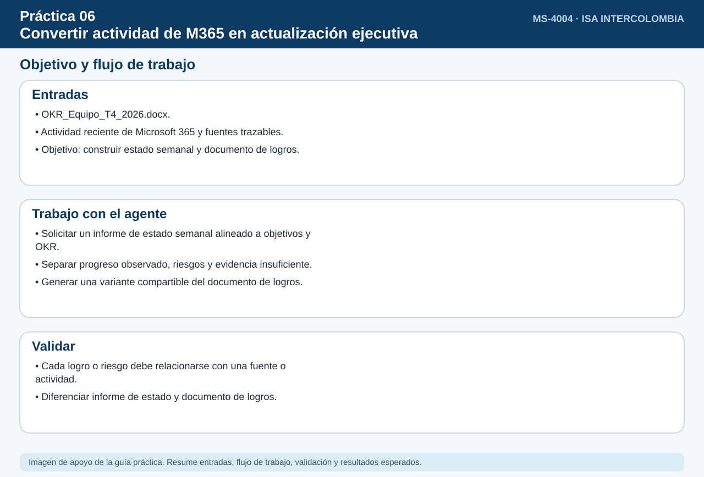
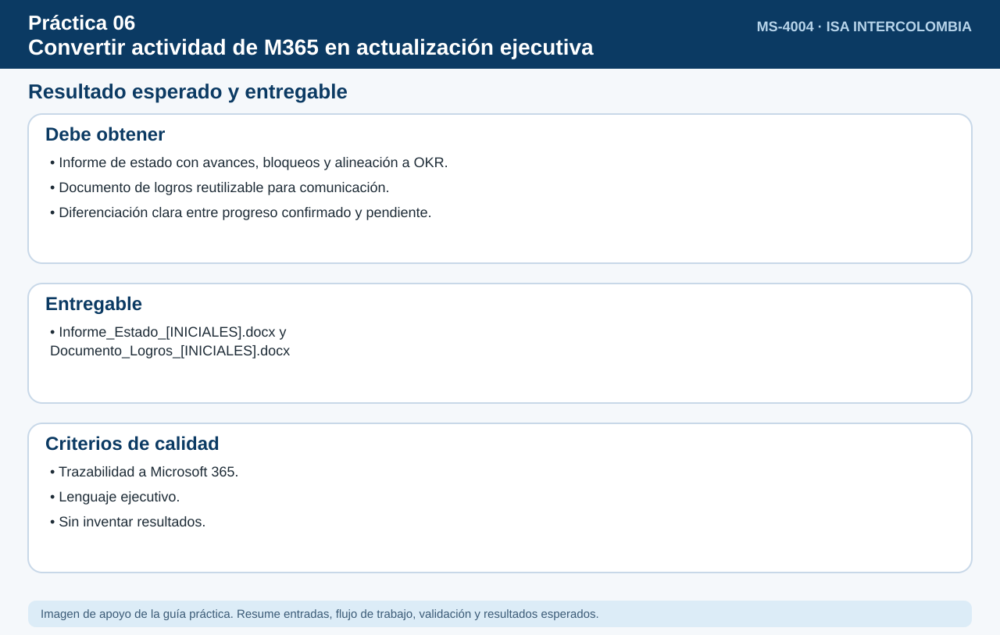

# Práctica 6. Convertir la actividad de Microsoft 365 en una actualización ejecutiva de estado

## Objetivo de la práctica:

Al finalizar la práctica, serás capaz de:

- Generar con el Agente de actualización de estado un informe semanal trazable a fuentes de Microsoft 365.
- Vincular actividades y resultados con objetivos/OKR, diferenciando progreso observado de evidencia insuficiente.
- Generar un documento de logros y su variante compartible para el responsable.
- Distinguir cuándo usar un informe de estado y cuándo un documento de logros.



## Duración aproximada:

- 15 minutos.

## Tabla de ayuda:

| Elemento | Valor |
|---|---|
| Dónde trabajar | Aplicación Microsoft 365 Copilot > Agentes > Agente de actualización de estado |
| Archivos de la práctica | [OKR_Equipo_T4_2026.docx](recursos/OKR_Equipo_T4_2026.docx) |
| Periodo a analizar | Últimos 7 días |

## Instrucciones

Cada semana el participante debe informar a su responsable qué logró. Su actividad está repartida en Outlook, Teams, reuniones y archivos, incluida la que generó en las prácticas anteriores de este curso. Usará el Agente de actualización de estado para producir un informe semanal trazable, vincularlo con los OKR del equipo y transformar los resultados en un documento de logros en Word listo para revisión.

### Tarea 1. Generar el informe de estado semanal (5 min)

**Paso 1.** Abrir **Microsoft Edge**, ingresar a [m365.cloud.microsoft](https://m365.cloud.microsoft/) e iniciar sesión con su cuenta corporativa si se solicita.

- **Alternativa:** Si no aparece el chat, seleccionar el icono **Copilot** en la barra lateral izquierda.

**Paso 2.** Seleccionar en el panel izquierdo **Agentes**, escribir `Agente de actualización de estado` en la búsqueda y abrir el agente.

- **Comprobación:** el nombre **Agente de actualización de estado** encima del cuadro de mensaje.
- **Si no aparece:** buscarlo en **Todos los agentes**; si no aparece, solicitar apoyo a quien administra el entorno.

**Paso 3.** Pegar el siguiente prompt y enviarlo:

```text
Genera mi informe de estado de los últimos 7 días a partir de mi actividad en Outlook, Teams, reuniones,
SharePoint y OneDrive. Organízalo en: logros relevantes, actividades en curso, colaboración y apoyo,
y prioridades para la siguiente semana. Indica la fuente de cada punto y no incluyas nada que no puedas sustentar.
```

- **Comprobación:** un informe con cuatro secciones (logros relevantes, actividades en curso, colaboración y apoyo, y prioridades) y referencias a correos, chats, reuniones o archivos.

**Paso 4.** Hacer clic en dos referencias del informe (correo, chat o archivo) y comprobar que lo que dice el informe coincide con la fuente.

- **Alternativa:** Si un punto no tiene fuente o la fuente no lo respalda, escribir: *"Elimina o marca como no verificable el punto sobre [tema]"*.

### Tarea 2. Alinear actividades con los OKR (4 min)

**Paso 1.** Pegar el siguiente prompt (insertar `/OKR_Equipo_T4_2026` con el selector de archivos):

```text
Vincula las actividades y resultados del informe con cada objetivo y resultado clave de /OKR_Equipo_T4_2026.
Para cada KR indica: progreso observado con evidencia, o "evidencia insuficiente" si no hay actividad que lo respalde.
```

- **Cómo insertar los archivos:** cada texto que empieza con `/` es un archivo: borrarlo, escribir `/` y las primeras letras del nombre, y elegir el archivo en la lista. Si no aparece, usar **+** > **Cargar desde OneDrive** > `Laboratorio_Copilot_ISA/Practica06`.
- **Comprobación:** una tabla con los 3 objetivos y sus 6 resultados clave (KR1.1 a KR3.2), con el progreso observado y la evidencia, o "evidencia insuficiente".

**Paso 2.** Verificar en cada KR si existe actividad recuperable con fuente comprobable. No dar por cumplidos **KR2.1**, **KR3.1** o **KR3.2** solo por haber ejecutado alguna práctica; marcar **evidencia insuficiente** cuando el agente no tenga acceso a una fuente que documente el resultado.

- **Si no aparece:** preguntar: *"¿Qué evidencia tienes para KR3.2?"*

### Tarea 3. Crear el documento de logros y su variante compartible (4 min)

**Paso 1.** Pegar el siguiente prompt:

```text
Transforma los principales resultados del periodo en un documento de logros. Para cada logro separa:
logro, impacto y colaboración. Luego genera una variante breve y compartible dirigida a mi responsable.
```

- **Comprobación:** un documento de logros con tres partes por logro (logro, impacto, colaboración) y, al final, una versión breve dirigida al responsable.

**Paso 2.** Crear un **Documento en blanco** en Word (escritorio o [office.com](https://www.office.com/)). En Copilot, seleccionar **Copiar** debajo del informe de estado (Tarea 1) y la tabla de OKR (Tarea 2) y pegar en Word con **Ctrl+V**.

- **Alternativa:** Si una tabla se pega como texto plano, pegar con **Ctrl+Shift+V** o pedir a Copilot: *"Entrega la tabla en formato de tabla"*.

**Paso 3.** Guardar el archivo en **OneDrive > Laboratorio_Copilot_ISA > Entregables** con el nombre `Informe_Estado_[INICIALES].docx`: en Word de escritorio, **Archivo > Guardar como**; en Word para la web, hacer clic en el nombre del documento en la parte superior y elegir la carpeta.

**Paso 4.** Crear otro **Documento en blanco** en Word y pegar solo el documento de logros y su variante revisada para el responsable; guardarlo con el nombre `Documento_Logros_[INICIALES].docx`.

- **Importante:** no compartir el documento; queda listo para revisión.

### Tarea 4. Comparar formatos (2 min)

**Paso 1.** Abrir `Informe_Estado_[INICIALES].docx` y agregar al final el título **Cuándo usar cada formato** con dos líneas: una para el **informe de estado** (seguimiento semanal de actividades y prioridades) y otra para el **documento de logros** (comunicar impacto y colaboración, por ejemplo en evaluaciones). Guardar con **Ctrl+S**.

### Resultado esperado




- Informe de estado semanal con fuentes.
- Alineación de actividades con OKR.
- Documento de logros en Word con variante compartible.

**Entregable:** informe de estado semanal, alineación con objetivos/OKR (`Informe_Estado_[INICIALES].docx`) y documento de logros en Word listo para revisión (`Documento_Logros_[INICIALES].docx`).
