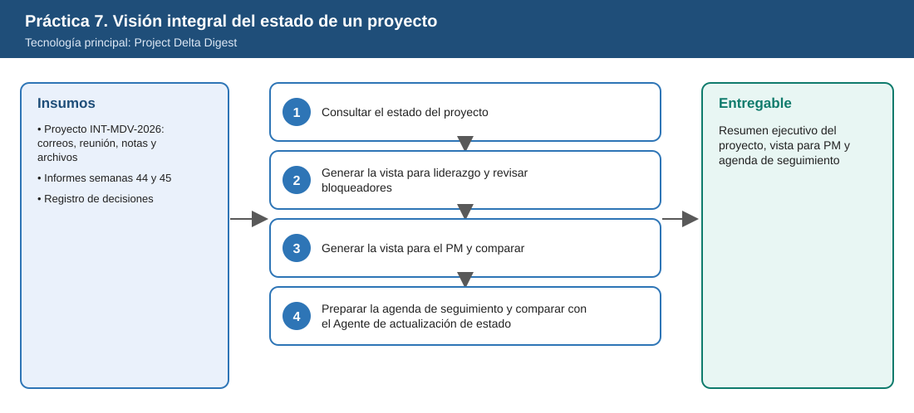
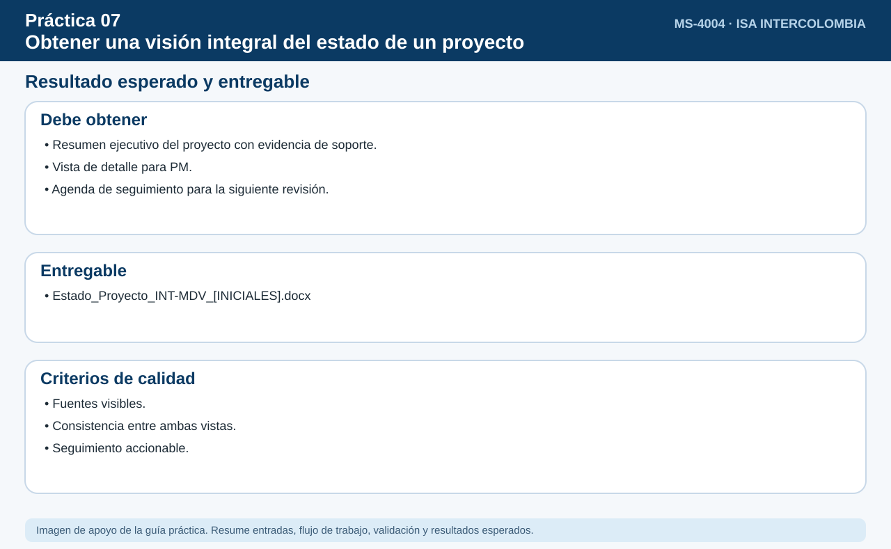

# Práctica 7. Obtener una visión integral del estado de un proyecto

## Objetivo de la práctica:

Al finalizar la práctica, serás capaz de:

- Consultar con Project Delta Digest el estado de un proyecto con avances, hitos, bloqueadores, riesgos y decisiones, con sus fuentes.
- Generar una vista para liderazgo y otra para el PM y comparar cómo cambia el nivel de detalle.
- Diferenciar información confirmada de la incompleta, desactualizada o no verificable.
- Preparar una agenda de seguimiento basada en bloqueadores y decisiones pendientes, previa confirmación.



## Duración aproximada:

- 15 minutos.

## Tabla de ayuda:

| Elemento | Valor |
|---|---|
| Dónde trabajar | Aplicación Microsoft 365 Copilot > Agentes > Project Delta Digest |
| Archivos de la práctica | [Evolucion_INT-MDV_Semanas44_45.docx](recursos/Evolucion_INT-MDV_Semanas44_45.docx)<br>[Registro_Decisiones_INT-MDV.xlsx](recursos/Registro_Decisiones_INT-MDV.xlsx) |
| Código del proyecto | `INT-MDV-2026` |
| Palabras clave | Mirador del Valle, INT-MDV |

## Instrucciones

El proyecto **INT-MDV-2026** tiene señales en correos, archivos, conversaciones y reuniones. El participante usará Project Delta Digest para obtener una revisión integral del proyecto, generar una vista para liderazgo y otra para el gerente del proyecto (PM), distinguir información confirmada de la incompleta y preparar la agenda de la próxima reunión de seguimiento. Al final comparará este agente con el Agente de actualización de estado.

### Tarea 1. Consultar el estado del proyecto (4 min)

**Paso 1.** Abrir **Microsoft Edge**, ingresar a [m365.cloud.microsoft](https://m365.cloud.microsoft/) e iniciar sesión con su cuenta corporativa si se solicita.

- **Alternativa:** Si no aparece el chat, seleccionar el icono **Copilot** en la barra lateral izquierda.

**Paso 2.** Seleccionar en el panel izquierdo **Agentes**, escribir `Project Delta Digest` en la búsqueda y abrir el agente.

- **Comprobación:** el nombre **Project Delta Digest** encima del cuadro de mensaje.
- **Si no aparece:** buscarlo en **Todos los agentes**; si no aparece, solicitar apoyo a quien administra el entorno.

**Paso 3.** Pegar el siguiente prompt y enviarlo:

```text
Revisa el estado actual del proyecto INT-MDV-2026 (Mirador del Valle). Identifica avances, entregables completados,
actividades en progreso, próximos hitos, bloqueadores, elementos estancados, riesgos y decisiones recientes.
Indica la fuente de cada hallazgo.
```

- **Comprobación:** una revisión del proyecto organizada en avances, entregables completados, actividades en progreso, próximos hitos, bloqueadores, elementos estancados, riesgos y decisiones recientes, con referencias a sus fuentes.

**Paso 4.** Comprobar que aparezcan los cuatro hallazgos clave: ventana de **30 h** frente a 36 h planeadas, permiso ambiental con respuesta el **25-nov**, cliente que pide **reprogramar a diciembre** y **plan con comunidades** sin avance desde hace 2 semanas.

- **Alternativa:** Si el agente no encuentra el proyecto, repetir con la palabra clave "Mirador del Valle" o insertar `/Evolucion_INT-MDV_Semanas44_45` y revisar la fuente de conocimiento configurada según la Setup Guide si continúa sin resultados.

### Tarea 2. Generar la vista para liderazgo y revisar bloqueadores (4 min)

**Paso 1.** Pegar el siguiente prompt:

```text
Genera una vista para liderazgo: resultados, riesgos, hitos, fechas y aspectos que requieren atención, con poco detalle operativo.
```

- **Comprobación:** una vista más corta centrada en resultados, riesgos, hitos y fechas, con poco detalle operativo.

**Paso 2.** Pegar el siguiente prompt:

```text
Para cada bloqueador y riesgo indica si requiere seguimiento, escalación o decisión, y clasifica la información como
confirmada, incompleta, desactualizada o no verificable.
```

- **Comprobación:** cada bloqueador y riesgo con dos etiquetas: una acción (seguimiento, escalación o decisión) y la calidad de la información (confirmada, incompleta, desactualizada o no verificable).

**Paso 3.** Revisar que el permiso ambiental y la ventana del operador estén marcados como **escalación** o **decisión**, que la solicitud del cliente de reprogramar a diciembre aparezca como asunto que requiere **decisión**, y que el plan con comunidades se marque como **estancado** o **incompleto**.

### Tarea 3. Generar la vista para el PM y comparar (3 min)

**Paso 1.** Pegar el siguiente prompt:

```text
Genera ahora una versión para el gerente del proyecto (PM), con el detalle operativo necesario para gestionar las actividades.
```

- **Comprobación:** una versión más extensa con actividades, responsables y fechas operativas.

**Paso 2.** Abrir un **Documento en blanco** de Word y escribir tres diferencias entre la vista de liderazgo y la del PM. Por ejemplo: **extensión** (número de líneas), **nivel de detalle** (decisiones frente a tareas) y **tipo de acción** (escalar frente a ejecutar).

### Tarea 4. Preparar la agenda de seguimiento y comparar con el Agente de actualización de estado (4 min)

**Paso 1.** Pegar el siguiente prompt:

```text
Con base en los bloqueadores y decisiones pendientes, propón la agenda para la próxima reunión de seguimiento.
Muéstramela primero para confirmarla antes de darla por final.
```

- **Comprobación:** una propuesta de agenda y una pregunta del agente para que usted la confirme o la ajuste.

**Paso 2.** Revisar la agenda: debe incluir la ventana del operador, el permiso ambiental, la respuesta al cliente y el vocero. Responder *"Confirmo la agenda"* o pedir un ajuste concreto (por ejemplo, *"Agrega 10 minutos para el plan con comunidades"*).

**Paso 3.** Copiar y pegar en el documento de Word de la Tarea 3 la vista de liderazgo, la vista para el PM y la agenda confirmada. Al final, agregar una línea: *"Agente de actualización de estado: actividad de una persona o equipo. Project Delta Digest: seguimiento integral de un proyecto."*

**Paso 4.** Guardar el archivo en **OneDrive > Laboratorio_Copilot_ISA > Entregables** con el nombre `Estado_Proyecto_INT-MDV_[INICIALES].docx`: en Word de escritorio, **Archivo > Guardar como**; en Word para la web, hacer clic en el nombre del documento en la parte superior y elegir la carpeta.

### Resultado esperado




- Resumen ejecutivo del estado del proyecto con fuentes.
- Vista para PM.
- Agenda de seguimiento confirmada.

**Entregable:** resumen ejecutivo del estado del proyecto, vista para PM y agenda de seguimiento basada en bloqueadores y decisiones pendientes (`Estado_Proyecto_INT-MDV_[INICIALES].docx`).
