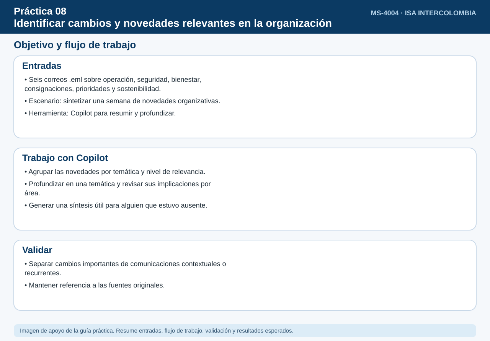
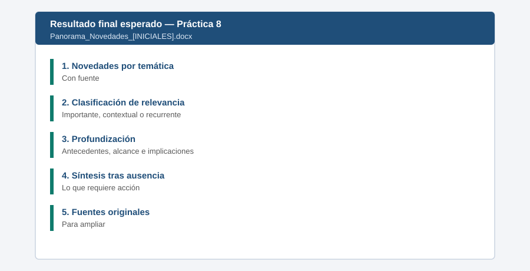

# Práctica 8. Identificar cambios y novedades relevantes en la organización

## Objetivo de la práctica:

Al finalizar la práctica, serás capaz de:

- Obtener un resumen de novedades de la última semana agrupado por temática.
- Diferenciar cambios importantes, información contextual y comunicaciones recurrentes.
- Profundizar en una temática para comprender antecedentes, alcance e implicaciones por área.
- Sintetizar lo ocurrido durante una ausencia con referencias a las fuentes originales.



## Duración aproximada:

- 12 minutos.

## Tabla de ayuda:

| Elemento | Valor |
|---|---|
| Dónde trabajar | Aplicación Microsoft 365 Copilot > Agentes > Resumen personal de noticias |
| Archivos de la práctica | [Comunicado_Liderazgo_Prioridades.eml](recursos/Comunicado_Liderazgo_Prioridades.eml)<br>[Cambio_Procedimiento_Consignaciones.eml](recursos/Cambio_Procedimiento_Consignaciones.eml)<br>[Iniciativa_Sostenibilidad_SF6.eml](recursos/Iniciativa_Sostenibilidad_SF6.eml)<br>[Alerta_Seguridad_Correo.eml](recursos/Alerta_Seguridad_Correo.eml)<br>[Actualizacion_Operacion_Infraestructura.eml](recursos/Actualizacion_Operacion_Infraestructura.eml)<br>[Boletin_Bienestar_Semanal.eml](recursos/Boletin_Bienestar_Semanal.eml) |
| Periodo documentado | Semana del 2 al 6 de noviembre de 2026 |
| Preparación | Importar los seis `.eml` mediante nuevo Outlook, según la Setup Guide |

## Instrucciones

Durante la semana se difundieron comunicaciones del liderazgo, un cambio de procedimiento, una iniciativa de sostenibilidad, una alerta de seguridad, una actualización operativa y un boletín recurrente. Los seis mensajes se entregan en `.eml` para preparar el buzón de Outlook antes del ejercicio. El participante usará el Agente de resumen personal de noticias para entender qué es relevante para su trabajo, profundizar en un tema y ponerse al día tras simular varios días de ausencia.

### Tarea 1. Resumir las novedades de la semana por temática (4 min)

**Paso 1.** Abrir **Microsoft Edge**, ingresar a [m365.cloud.microsoft](https://m365.cloud.microsoft/) e iniciar sesión con su cuenta corporativa si se solicita.

- **Alternativa:** Si no aparece el chat, seleccionar el icono **Copilot** en la barra lateral izquierda.

**Paso 2.** Seleccionar en el panel izquierdo **Agentes**, escribir `Resumen personal de noticias` en la búsqueda y abrir el agente.

- **Comprobación:** el nombre **Resumen personal de noticias** encima del cuadro de mensaje.
- **Si no aparece:** buscarlo en **Todos los agentes**; si no aparece, solicitar apoyo a quien administra el entorno.

**Paso 3.** Responder con el siguiente texto si el agente pregunta por sus intereses o preferencias: *"Proyectos de infraestructura, operación de subestaciones, procedimientos internos, sostenibilidad y seguridad de la información"*.

**Paso 4.** Pegar el siguiente prompt y enviarlo:

```text
Resume las novedades organizativas y operativas del 2 al 6 de noviembre de 2026 relevantes para mi trabajo en proyectos de infraestructura.
Agrúpalas por temática y clasifícalas como: cambio importante, información contextual o comunicación recurrente.
Incluye la fuente de cada novedad.
```

- **Comprobación:** novedades agrupadas por temática, cada una con clasificación y fuente. Si el material se importó en otra fecha, buscar expresamente el periodo indicado en el prompt en lugar de usar únicamente «última semana».

**Paso 5.** Comparar la clasificación con la esperada: **cambio de procedimiento de consignaciones** y **alerta de seguridad** como *cambio importante*; **prioridades del liderazgo**, **iniciativa de SF6** y **actualización operativa** como *importantes* o *contextuales* según su trabajo; **boletín de bienestar** como *recurrente*.

- **Alternativa:** Si la búsqueda del agente no devuelve un correo importado, abrir ese mensaje desde Outlook y proporcionar el contenido al agente. Solicitar una clasificación de la fuente e indicar que se aportó manualmente.

### Tarea 2. Profundizar en una temática (4 min)

**Paso 1.** Pegar el siguiente prompt:

```text
Profundiza en el cambio del procedimiento de solicitud de consignaciones: antecedentes, qué cambia, desde cuándo,
a quién aplica e implicaciones para Operación, Proyectos y Comunicaciones.
```

- **Comprobación:** los antecedentes, qué cambia, desde cuándo, a quién aplica y las implicaciones por área.

**Paso 2.** Comprobar tres datos: el plazo pasa de **15 a 20 días hábiles**, se exige un **plan de comunicación aprobado** y la vigencia comienza el **1 de diciembre de 2026**.

**Paso 3.** Escribir: *"¿Este cambio afecta a la intervención INT-MDV-2026 programada para el 28 de noviembre?"*

- **Comprobación:** una respuesta que indique que la intervención inicia antes de la vigencia del cambio, aunque conviene aplicarlo para futuras intervenciones.

### Tarea 3. Ponerse al día después de una ausencia (4 min)

**Paso 1.** Pegar el siguiente prompt:

```text
Estuve ausente del 2 al 6 de noviembre. ¿Qué cambió en ese periodo que debo conocer al volver? Prioriza lo que requiere acción
de mi parte e indica la fuente original para ampliar cada tema.
```

- **Comprobación:** una síntesis priorizada que empieza por lo que requiere su acción (por ejemplo, la alerta de seguridad y el cambio de procedimiento), con un enlace o referencia a cada fuente original.

**Paso 2.** Hacer clic en una de las fuentes de la síntesis para comprobar que abre la comunicación original.

**Paso 3.** Crear un **Documento en blanco** en Word (escritorio o [office.com](https://www.office.com/)). En Copilot, seleccionar **Copiar** debajo del panorama (Tarea 1), la profundización (Tarea 2) y la síntesis (Tarea 3) y pegar en Word con **Ctrl+V**.

- **Alternativa:** Si una tabla se pega como texto plano, pegar con **Ctrl+Shift+V** o pedir a Copilot: *"Entrega la tabla en formato de tabla"*.

**Paso 4.** Guardar el archivo en **OneDrive > Laboratorio_Copilot_ISA > Entregables** con el nombre `Panorama_Novedades_[INICIALES].docx`: en Word de escritorio, **Archivo > Guardar como**; en Word para la web, hacer clic en el nombre del documento en la parte superior y elegir la carpeta.

### Resultado esperado




- Panorama de novedades clasificado por temática y relevancia.
- Análisis de implicaciones de un cambio.
- Síntesis de regreso con fuentes originales.

**Entregable:** panorama de novedades organizativas clasificado por temática, relevancia e implicaciones, con referencias a las fuentes originales (`Panorama_Novedades_[INICIALES].docx`).
