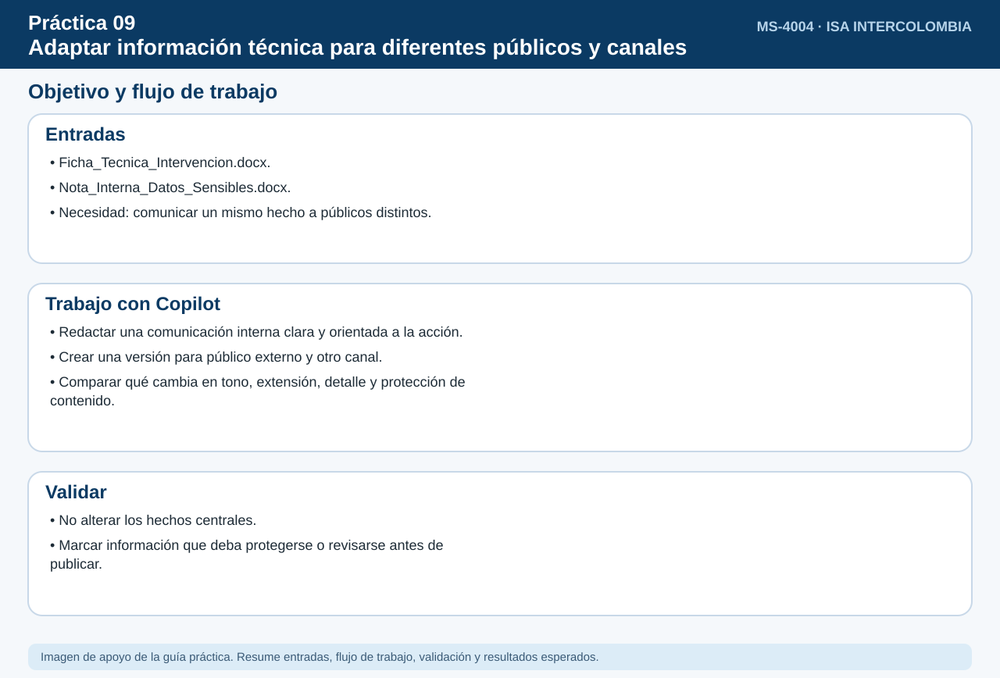
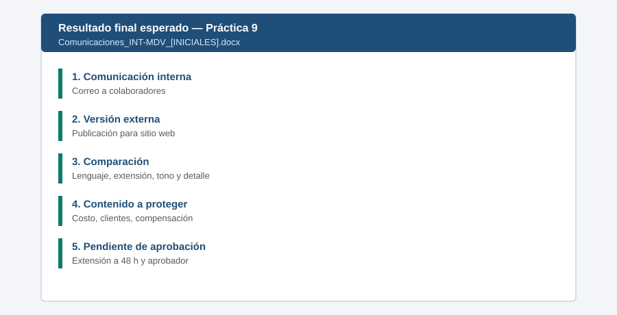

# Práctica 9. Adaptar información técnica para diferentes públicos y canales

## Objetivo de la práctica:

Al finalizar la práctica, serás capaz de:

- Transformar información técnica en una comunicación interna clara y orientada a la acción.
- Adaptar el mismo acontecimiento para un público externo y otro canal sin alterar los hechos centrales.
- Comparar cambios de lenguaje, extensión, tono y nivel de detalle entre versiones.
- Identificar contenido que debe protegerse, modificarse o someterse a revisión antes de publicarse.



## Duración aproximada:

- 15 minutos.

## Tabla de ayuda:

| Elemento | Valor |
|---|---|
| Dónde trabajar | Aplicación Microsoft 365 Copilot > Agentes > Diseñador de comunicaciones |
| Archivos de la práctica | [Ficha_Tecnica_Intervencion.docx](recursos/Ficha_Tecnica_Intervencion.docx) (incluye criterios de divulgación) |
| Canal interno | Correo a colaboradores |
| Canal externo | Publicación breve para sitio web o redes |

## Instrucciones

La intervención INT-MDV-2026 debe comunicarse a colaboradores y a públicos externos. El participante partirá de una ficha técnica y usará el Diseñador de comunicaciones para producir un mensaje interno orientado a la acción y una versión externa para otro canal, sin alterar los hechos. Después incorporará datos internos o sujetos a aprobación y pedirá al agente identificar qué debe protegerse o revisarse antes de publicar.

### Tarea 1. Crear la comunicación interna para colaboradores (5 min)

**Paso 1.** Abrir **Microsoft Edge**, ingresar a [m365.cloud.microsoft](https://m365.cloud.microsoft/) e iniciar sesión con su cuenta corporativa si se solicita.

- **Alternativa:** Si no aparece el chat, seleccionar el icono **Copilot** en la barra lateral izquierda.

**Paso 2.** Seleccionar en el panel izquierdo **Agentes**, escribir `Diseñador de comunicaciones` en la búsqueda y abrir el agente (plantilla original de Microsoft: **Corporate Communications Crafter**).

- **Comprobación:** el nombre **Diseñador de comunicaciones** encima del cuadro de mensaje.
- **Si no aparece:** buscarlo en **Todos los agentes**; si no aparece, solicitar apoyo a quien administra el entorno.

**Paso 3.** Pegar el siguiente prompt (insertar `/Ficha_Tecnica_Intervencion` con el selector de archivos):

```text
Con base en /Ficha_Tecnica_Intervencion, redacta un correo interno para colaboradores sobre la intervención.
Explica en lenguaje claro el propósito, el periodo, las posibles afectaciones y, sobre todo, qué acciones deben realizar.
Máximo 200 palabras.
```

- **Cómo insertar los archivos:** cada texto que empieza con `/` es un archivo: borrarlo, escribir `/` y las primeras letras del nombre, y elegir el archivo en la lista. Si no aparece, usar **+** > **Cargar desde OneDrive** > `Laboratorio_Copilot_ISA/Practica09`.
- **Comprobación:** un borrador de correo interno de hasta 200 palabras con asunto, propósito, fechas, afectaciones y una sección de acciones.

**Paso 4.** Verificar que el correo incluya las tres acciones de la ficha técnica: **no programar trabajos** en la subestación esa semana, **confirmar turnos** de disponibilidad y **canalizar consultas externas** a Comunicaciones.

- **Si no aparece:** escribir: *"Agrega una sección Qué debes hacer con las tres acciones requeridas de la ficha"*.

### Tarea 2. Adaptar el mensaje a un público externo y otro canal (5 min)

**Paso 1.** Pegar el siguiente prompt:

```text
Adapta el mismo acontecimiento para la comunidad y los usuarios externos, en una publicación breve para el sitio web
(máximo 100 palabras). Sin tecnicismos ni datos de operación interna. Mantén fecha, propósito y afectaciones.
```

- **Comprobación:** una publicación de hasta 100 palabras sin términos técnicos (por ejemplo, sin "150 MVA" ni "bahía").

**Paso 2.** Escribir: *"Compara la comunicación interna y la externa en una tabla con las filas lenguaje, extensión, tono y nivel de detalle"*.

- **Comprobación:** una tabla de 4 filas y 2 columnas (interna y externa).

**Paso 3.** Comprobar que la fecha (**28 y 29 de noviembre**), el propósito y las afectaciones sean los mismos en ambas versiones.

- **Si no aparece:** escribir: *"Corrige la versión externa para que la fecha y las afectaciones coincidan con la interna"*.

### Tarea 3. Identificar contenido a proteger o revisar (5 min)

**Paso 1.** Pegar el siguiente prompt (conservar seleccionada la misma ficha técnica y consultar su sección 4):

```text
Revisa la sección 4 de /Ficha_Tecnica_Intervencion. ¿Qué contenido debería protegerse, modificarse o someterse a revisión
antes de publicar cada comunicación? Justifica cada punto e indica quién debería aprobarlo.
```

- **Archivos:** insertarlos con `/`, igual que antes.
- **Comprobación:** una lista de contenidos que deben protegerse, modificarse o revisarse, con la justificación y el aprobador sugerido.

**Paso 2.** Verificar cuatro elementos: el **costo de 4.200 MCOP** y los **nombres de los clientes** se protegen, la **compensación** queda en revisión de Jurídica y la **extensión a 48 horas** no se publica porque no está aprobada.

- **Si no aparece:** preguntar por el que falte: *"¿Puedo publicar [dato]?"*

**Paso 3.** Crear un **Documento en blanco** en Word (escritorio o [office.com](https://www.office.com/)). En Copilot, seleccionar **Copiar** debajo de la comunicación interna, la externa, la tabla comparativa y la revisión y pegar en Word con **Ctrl+V**.

- **Alternativa:** Si una tabla se pega como texto plano, pegar con **Ctrl+Shift+V** o pedir a Copilot: *"Entrega la tabla en formato de tabla"*.

**Paso 4.** Guardar el archivo en **OneDrive > Laboratorio_Copilot_ISA > Entregables** con el nombre `Comunicaciones_INT-MDV_[INICIALES].docx`: en Word de escritorio, **Archivo > Guardar como**; en Word para la web, hacer clic en el nombre del documento en la parte superior y elegir la carpeta.

### Resultado esperado




- Comunicación interna orientada a la acción.
- Versión externa adaptada a otro canal.
- Lista de contenido a proteger o revisar.

**Entregable:** comunicación interna y versión adaptada para un público externo (`Comunicaciones_INT-MDV_[INICIALES].docx`).
