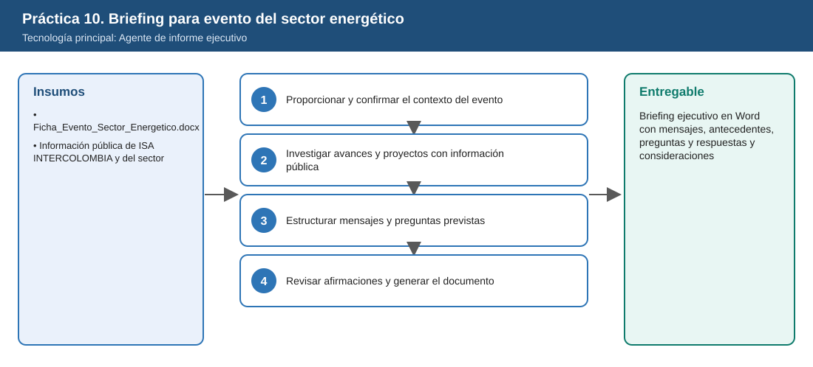
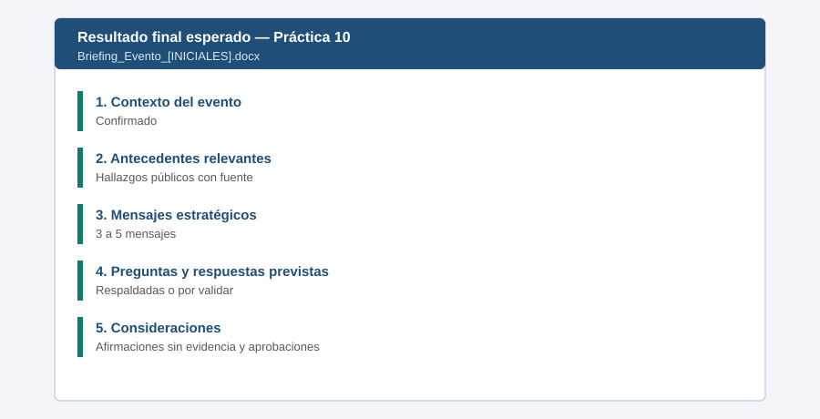

# Práctica 10. Presentar los avances e innovaciones de ISA ante el sector energético

## Objetivo de la práctica:

Al finalizar la práctica, serás capaz de:

- Proporcionar al agente el contexto del evento y confirmarlo antes de preparar el briefing.
- Investigar avances, proyectos e innovaciones con información pública y fuentes especializadas.
- Estructurar mensajes estratégicos y preguntas y respuestas previstas.
- Diferenciar hechos respaldados por fuentes públicas de expectativas que requieren validación.



## Duración aproximada:

- 15 minutos.

## Tabla de ayuda:

| Elemento | Valor |
|---|---|
| Dónde trabajar | Aplicación Microsoft 365 Copilot > Agentes > Agente de informe ejecutivo |
| Archivos de la práctica | [Ficha_Evento_Sector_Energetico.docx](recursos/Ficha_Evento_Sector_Energetico.docx) |
| Evento | Foro de Transmisión y Confiabilidad 2026 (caso del curso), 3-dic-2026 |
| Regla del escenario | Solo información pública verificable, con fuente y fecha |

## Instrucciones

Un líder de ISA INTERCOLOMBIA intervendrá en el **Foro de Transmisión y Confiabilidad 2026** (evento del caso). El participante usará el Agente de informe ejecutivo para preparar el briefing: confirmar el contexto del evento, investigar información **pública** sobre avances y proyectos de la organización, estructurar mensajes estratégicos, anticipar preguntas y revisar qué afirmaciones carecen de evidencia o requieren aprobación.

### Tarea 1. Proporcionar y confirmar el contexto del evento (3 min)

**Paso 1.** Abrir **Microsoft Edge**, ingresar a [m365.cloud.microsoft](https://m365.cloud.microsoft/) e iniciar sesión con su cuenta corporativa si se solicita.

- **Alternativa:** Si no aparece el chat, seleccionar el icono **Copilot** en la barra lateral izquierda.

**Paso 2.** Seleccionar en el panel izquierdo **Agentes**, escribir `Agente de informe ejecutivo` en la búsqueda y abrir el agente.

- **Comprobación:** el nombre **Agente de informe ejecutivo** encima del cuadro de mensaje.
- **Si no aparece:** buscarlo en **Todos los agentes**; si no aparece, solicitar apoyo a quien administra el entorno.

**Paso 3.** Pegar el siguiente prompt (insertar `/Ficha_Evento_Sector_Energetico` con el selector de archivos):

```text
Voy a preparar la intervención de un líder de ISA INTERCOLOMBIA en el evento descrito en /Ficha_Evento_Sector_Energetico.
Antes de empezar, confirma conmigo el evento, la fecha, el formato, la audiencia y el objetivo.
```

- **Cómo insertar los archivos:** cada texto que empieza con `/` es un archivo: borrarlo, escribir `/` y las primeras letras del nombre, y elegir el archivo en la lista. Si no aparece, usar **+** > **Cargar desde OneDrive** > `Laboratorio_Copilot_ISA/Practica10`.
- **Comprobación:** un resumen del evento (Foro de Transmisión y Confiabilidad 2026, 3 de diciembre, Bogotá, panel de 45 minutos con 8 minutos de intervención) y una pregunta para que usted lo confirme.

**Paso 4.** Revisar el resumen. Si es correcto, responder *"Confirmo, continúa"*; si algo no coincide con la ficha, corregirlo (por ejemplo, *"La intervención inicial es de 8 minutos"*).

### Tarea 2. Investigar avances y proyectos con información pública (4 min)

**Paso 1.** Pegar el siguiente prompt:

```text
Investiga avances, proyectos de modernización, innovaciones tecnológicas y mejoras de ISA INTERCOLOMBIA en transmisión de energía,
usando información pública de la organización y fuentes especializadas. Para cada hallazgo indica fuente y fecha.
Identifica logros, beneficios documentados, tendencias del sector y oportunidades futuras.
```

- **Comprobación:** una lista de avances y proyectos de ISA INTERCOLOMBIA, cada uno con una fuente y su fecha. La búsqueda puede tardar 1 o 2 minutos.

**Paso 2.** Hacer clic en dos fuentes y verificar que sean públicas (sitio oficial, informes publicados o medios especializados), que mencionen el dato y que tengan una fecha visible.

- **Alternativa:** Si una fuente no es pública o no tiene fecha, escribir: *"Descarta el hallazgo sobre [tema] porque su fuente no es verificable"*.

### Tarea 3. Estructurar mensajes y preguntas previstas (5 min)

**Paso 1.** Pegar el siguiente prompt:

```text
Estructura 3 a 5 mensajes estratégicos para presentar la evolución de ISA INTERCOLOMBIA y su contribución a la confiabilidad,
eficiencia y sostenibilidad. Luego prepara 6 preguntas probables de los asistentes (resultados, desafíos, inversiones,
innovación y proyectos futuros) con respuestas, marcando cada una como "respaldada por fuente pública" o "requiere validación".
```

- **Comprobación:** de 3 a 5 mensajes estratégicos y 6 preguntas con su respuesta, cada una marcada como "respaldada por fuente pública" o "requiere validación".

**Paso 2.** Leer las 6 respuestas: ninguna debe anunciar una inversión, una fecha o un proyecto que no aparezca en una fuente pública.

- **Si no aparece:** escribir: *"Marca como requiere validación la respuesta sobre [tema]"*.

### Tarea 4. Revisar afirmaciones y generar el documento (3 min)

**Paso 1.** Pegar el siguiente prompt:

```text
Revisa los mensajes y respuestas: identifica afirmaciones sin evidencia suficiente, información sensible y contenido que requiera
aprobación antes de comunicarse públicamente. Luego genera el briefing completo como documento.
```

- **Comprobación:** una lista de afirmaciones sin evidencia, información sensible y contenidos por aprobar, seguida del briefing completo.

**Paso 2.** Seleccionar **Abrir en Word** o **Exportar** si el agente ofrece esas opciones. Si no aparecen, crear un **Documento en blanco** en Word (escritorio o [office.com](https://www.office.com/)). En Copilot, seleccionar **Copiar** debajo del briefing y pegar en Word con **Ctrl+V**.

- **Alternativa:** Si una tabla se pega como texto plano, pegar con **Ctrl+Shift+V** o pedir a Copilot: *"Entrega la tabla en formato de tabla"*.

**Paso 3.** Guardar el archivo en **OneDrive > Laboratorio_Copilot_ISA > Entregables** con el nombre `Briefing_Evento_[INICIALES].docx`: en Word de escritorio, **Archivo > Guardar como**; en Word para la web, hacer clic en el nombre del documento en la parte superior y elegir la carpeta.

### Resultado esperado




- Contexto del evento confirmado.
- Hallazgos públicos con fuente y fecha.
- Mensajes, preguntas y respuestas revisados.

**Entregable:** documento Word con briefing ejecutivo para el evento, mensajes estratégicos, antecedentes relevantes, preguntas y respuestas previstas y consideraciones para la intervención (`Briefing_Evento_[INICIALES].docx`).
