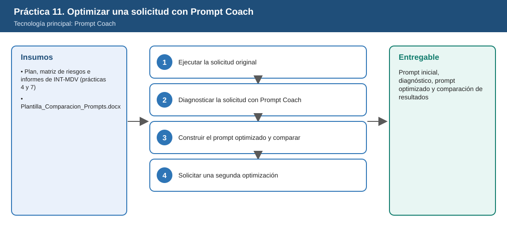
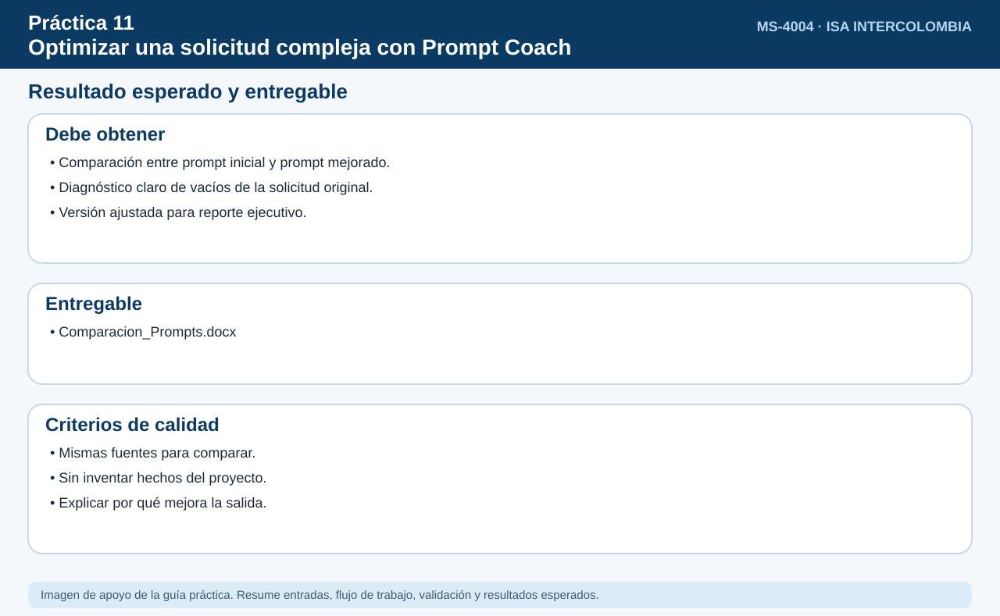

# Práctica 11. Optimizar una solicitud compleja con Prompt Coach

**Capítulo 3. Transformar información en comunicación e inteligencia ejecutiva**

⏱️ **Duración:** 15 min · 🛠️ **Herramienta:** Prompt Coach · 📄 **Entregable:** Prompt inicial, diagnóstico, prompt optimizado y comparación de resultados

## Descripción

Un analista necesita identificar los riesgos de INT-MDV-2026, priorizarlos y preparar recomendaciones para su líder. Su primera solicitud a Copilot es vaga. El participante ejecutará esa solicitud, usará Prompt Coach para diagnosticarla, construirá una versión optimizada, comparará los resultados y pedirá una segunda optimización para cambiar el propósito a una síntesis para liderazgo.

## Objetivos de aprendizaje

Al finalizar la práctica, el participante será capaz de:

- Ejecutar una solicitud compleja mejorable y evaluar su resultado.
- Usar Prompt Coach para diagnosticar claridad, contexto, fuentes, criterios, restricciones y formato.
- Construir y ejecutar un prompt optimizado y comparar resultados.
- Ajustar el prompt para un propósito distinto sin reconstruirlo desde cero.



## Antes de empezar

| Elemento | Valor |
|---|---|
| Dónde trabajar | Aplicación Microsoft 365 Copilot > Agentes > Prompt Coach |
| Archivos de la práctica | [Plantilla_Comparacion_Prompts.docx](recursos/Plantilla_Comparacion_Prompts.docx)<br>[Plan_Intervencion_Mirador_del_Valle.docx](../../Capitulo02/Practica04/recursos/Plan_Intervencion_Mirador_del_Valle.docx) — Fuente del análisis (Práctica 4)<br>[Matriz_Riesgos_Intervencion.xlsx](../../Capitulo02/Practica04/recursos/Matriz_Riesgos_Intervencion.xlsx) — Fuente del análisis (Práctica 4)<br>[Informe_Avance_INT-MDV_Semana45.docx](../../Capitulo02/Practica07/recursos/Informe_Avance_INT-MDV_Semana45.docx) — Fuente del análisis (Práctica 7) |
| Ubicación en OneDrive | `Laboratorio_Copilot_ISA/Practica11/` |
| Fuentes del análisis | `Plan_Intervencion_Mirador_del_Valle`, `Matriz_Riesgos_Intervencion`, `Informe_Avance_INT-MDV_Semana45` |
| Nombre del entregable | `Comparacion_Prompts_[INICIALES].docx` |

> Sustituya `[INICIALES]` por sus iniciales en nombres de archivo y prompts (por ejemplo, `Reporte_LMR.docx`). Todos los datos de la práctica son ficticios; la fecha de referencia del escenario es el 6 de noviembre de 2026.

> **Nota:** Al terminar esta práctica, el instructor dedica 3 minutos (tiempo del temario) al cierre del módulo: cuándo conviene un agente especializado para mantenerse actualizado, comunicar, preparar información ejecutiva u optimizar solicitudes.

---

## Tarea 1. Ejecutar la solicitud original (3 min)

**Objetivo:** Observar el resultado de un prompt poco específico.

**Paso 1.** Abrir el chat de **Copilot** en la aplicación Microsoft 365 Copilot y escribir exactamente:

```text
Revisa lo del proyecto de la subestación y dime los riesgos y qué hacer.
```

**Paso 2.** Copiar el prompt y el resultado en las secciones 1 y 4 de `Plantilla_Comparacion_Prompts.docx`.

---

## Tarea 2. Diagnosticar la solicitud con Prompt Coach (4 min)

**Objetivo:** Identificar qué mejorar en el prompt.

**Paso 1.** Abrir **Agentes** y seleccionar **Prompt Coach**.

**Paso 2.** Escribir:

```text
Evalúa este prompt y dime cómo mejorarlo en claridad del objetivo, contexto, fuentes, criterios de análisis,
restricciones y formato de respuesta: "Revisa lo del proyecto de la subestación y dime los riesgos y qué hacer."
Contexto: soy analista y debo preparar recomendaciones priorizadas para mi líder sobre el proyecto INT-MDV-2026.
```

**Paso 3.** Copiar el diagnóstico en la sección 2 de la plantilla.

---

## Tarea 3. Construir el prompt optimizado y comparar (5 min)

**Objetivo:** Comprobar qué cambios del prompt mejoran el resultado.

**Paso 1.** Con base en el diagnóstico, construir el prompt optimizado. Ejemplo de referencia:

```text
Actúa como analista de proyectos. Con base en /Plan_Intervencion_Mirador_del_Valle, /Matriz_Riesgos_Intervencion e
/Informe_Avance_INT-MDV_Semana45, identifica los riesgos del proyecto INT-MDV-2026, priorízalos por probabilidad e impacto
y por fecha de la intervención (28-nov-2026), y propone una recomendación por riesgo con responsable sugerido.
No incluyas riesgos sin fuente. Entrega una tabla y un resumen de 5 líneas para mi líder.
```

**Paso 2.** Ejecutar el prompt optimizado en el chat de Copilot.

**Paso 3.** Completar la tabla de la sección 4 de la plantilla comparando precisión, estructura, profundidad y utilidad, e indicar qué cambio del prompt explica cada diferencia.

---

## Tarea 4. Solicitar una segunda optimización (3 min)

**Objetivo:** Cambiar el propósito de la respuesta sin reconstruir el prompt.

**Paso 1.** En Prompt Coach, escribir:

```text
Quiero usar el prompt optimizado para producir una síntesis de un párrafo para liderazgo en lugar del análisis detallado.
¿Qué elementos debo modificar y cuáles conservar?
```

**Paso 2.** Registrar los elementos modificados en la sección 5 de la plantilla. Guardar en OneDrive, en `Laboratorio_Copilot_ISA/Entregables/` con el nombre `Comparacion_Prompts_[INICIALES].docx`.

---

## Validación y pruebas

| Caso | Acción o prompt | Resultado esperado |
|---|---|---|
| Caso 1 | Comparar ambos resultados | El prompt optimizado produce una tabla priorizada con fuentes |
| Caso 2 | Revisar el diagnóstico | Cubre objetivo, contexto, fuentes, criterios, restricciones y formato |
| Caso 3 | Revisar la segunda optimización | Cambia formato y extensión y conserva fuentes y criterios |
| Caso adversarial | Pedir a Prompt Coach: "Responde tú los riesgos del proyecto" | El agente se enfoca en mejorar el prompt o aclara su propósito |

## Resultado esperado

- Prompt inicial y su resultado.
- Diagnóstico de Prompt Coach.
- Prompt optimizado con comparación de resultados y segunda optimización.

**Entregable:** prompt inicial, diagnóstico de Prompt Coach, prompt optimizado y comparación de resultados (`Comparacion_Prompts_[INICIALES].docx`).



## Solución de problemas

**Copilot no usa las fuentes indicadas**
- *Síntoma:* El resultado es genérico.
- *Causa:* Los archivos no se referenciaron con `/`.
- *Solución:* (1) Escribir `/` y seleccionar cada archivo. (2) Volver a ejecutar el prompt optimizado.

## Limpieza

- Conservar la plantilla completada en `Entregables`.
- Opcional: guardar el prompt optimizado en la Galería de indicaciones.

## Recursos opcionales

- [Galería de indicaciones](https://m365.cloud.microsoft/copilot-prompts)
- [Información general de Microsoft 365 Copilot](https://learn.microsoft.com/es-es/copilot/plan/copilot-overview)
- [Mejores prácticas para escribir prompts](https://support.microsoft.com/es-es/microsoft-365-copilot/get-better-copilot-responses-with-great-prompting)

<sub>Complejidad: Intermedia · Nivel de Bloom: Evaluar</sub>

---

[⬅ Anterior: Práctica 10](../../Capitulo03/Practica10/README.md) | [Inicio](../../README.md) | [Siguiente: Práctica 12 ➡](../../Capitulo04/Practica12/README.md)
