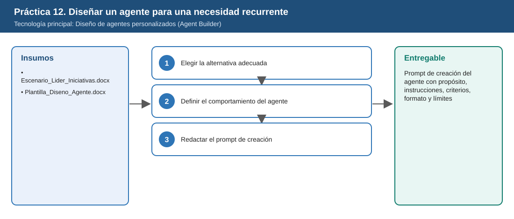
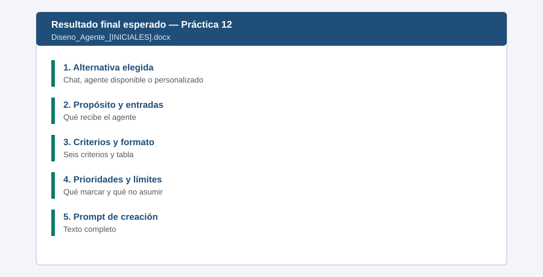

# Práctica 12. Diseñar un agente para dar seguimiento a una necesidad recurrente

**Capítulo 4. Combinar capacidades para resolver una necesidad completa**

---

# Metadatos

| Campo | Valor |
|---|---|
| Duración | 10 minutos |
| Complejidad | Intermedia |
| Nivel de Bloom | Crear |
| Tecnología Principal | Diseño de agentes personalizados (Agent Builder) |

**Distribución del tiempo**

| Actividad | Tiempo |
|---|---|
| Tarea 1. Elegir la alternativa adecuada | 3 min |
| Tarea 2. Definir el comportamiento del agente | 4 min |
| Tarea 3. Redactar el prompt de creación | 3 min |
| **Total** | **10 min** |

> Antes de esta práctica el instructor dedica 5 minutos (tiempo del temario) a explicar cuándo una actividad recurrente justifica crear un agente personalizado.

---

# Descripción General

Laura, líder de un equipo (ficticia), revisa cada semana el avance de 5 iniciativas con solicitudes distintas a Copilot y obtiene análisis inconsistentes. El participante decidirá si la necesidad se resuelve mejor con Copilot Chat, un agente disponible o un agente personalizado y, tras compararlos, diseñará el prompt de creación de un agente que aplique siempre los mismos criterios: avance, desviaciones, riesgos, bloqueos, decisiones requeridas y próximos pasos.

---

# Objetivos de Aprendizaje

Al finalizar la práctica, el participante será capaz de:

- Comparar Copilot Chat, un agente disponible y un agente personalizado para una necesidad recurrente.
- Definir propósito, información de entrada, criterios, estructura de respuesta y situaciones prioritarias del agente.
- Definir qué no debe asumir el agente y cómo actuar ante información incompleta o contradictoria.
- Redactar el prompt de creación del agente con propósito, instrucciones, criterios, formato y límites.

---

# Objetivo Visual

El diagrama resume los insumos, las tareas y el entregable de la práctica.



---

# Prerrequisitos

## Conocimientos

- Uso de Microsoft 365 Copilot en el trabajo cotidiano, incluida la construcción de prompts.
- Diferencia entre Copilot Chat, agentes preconstruidos y agentes personalizados (exposición del instructor).

## Accesos Requeridos

- Licencia de Microsoft 365 Copilot (Premium) asignada a la cuenta del participante.
- Permiso para crear agentes (se usará en la Práctica 13).

---

# Tabla de Ayuda

Utilice esta información durante el desarrollo de la práctica.

| Elemento | Valor |
|---|---|
| Entorno | Tenant de Microsoft 365 de ISA INTERCOLOMBIA habilitado para el curso |
| URL | [m365.cloud.microsoft](https://m365.cloud.microsoft/) |
| Usuario | Cuenta corporativa del participante |
| Contraseña | La del participante; no se publica en este repositorio |
| Aplicación | Microsoft Word (plantilla de diseño) |
| Criterios de Laura | Avance, desviaciones, riesgos, bloqueos, decisiones requeridas, próximos pasos |
| Recurso adicional | Nombre del entregable: `Diseno_Agente_[INICIALES].docx` |

---

# Entorno de Laboratorio

| Componente | Versión | Uso | Fuente Oficial |
|---|---|---|---|
| Aplicación Microsoft 365 Copilot | Servicio administrado | Chat de Copilot y agentes | [https://m365.cloud.microsoft/](https://m365.cloud.microsoft/) |
| Microsoft Edge | Versión estable vigente | Navegador del laboratorio | [https://www.microsoft.com/es-es/edge](https://www.microsoft.com/es-es/edge) |
| Microsoft Word con Copilot | Microsoft 365 Apps, Canal Actual | Consolidar entregables | [https://learn.microsoft.com/es-es/copilot/plan/copilot-overview](https://learn.microsoft.com/es-es/copilot/plan/copilot-overview) |

---

# Recursos

Utilice los siguientes recursos durante el desarrollo de la práctica.

| Recurso | Descripción |
|---|---|
| [Escenario_Lider_Iniciativas.docx](recursos/Escenario_Lider_Iniciativas.docx) | Necesidad recurrente de la líder, criterios y situaciones prioritarias |
| [Plantilla_Diseno_Agente.docx](recursos/Plantilla_Diseno_Agente.docx) | Plantilla para documentar el diseño y el prompt de creación |

## Archivos de la práctica

```text
Capitulo04/Practica12/recursos/Escenario_Lider_Iniciativas.docx
Capitulo04/Practica12/recursos/Plantilla_Diseno_Agente.docx
```

Antes de la práctica, estos archivos deben estar en OneDrive, en `Laboratorio_Copilot_ISA/Practica12/` (ver [Setup_Guide.md](../../Setup_Guide.md)).

---

# Tarea 1. Elegir la alternativa adecuada

## Objetivo

Justificar por qué la necesidad requiere un agente personalizado.

## Instrucciones

### Paso 1

Abrir `Escenario_Lider_Iniciativas.docx` y leer la necesidad.

### Paso 2

Completar en la plantilla una comparación breve:

| Alternativa | ¿Aplica los mismos criterios cada vez? | ¿Requiere repetir instrucciones? | Conclusión |
|---|---|---|---|
| Copilot Chat | No garantizado | Sí | |
| Agente disponible | No conoce los criterios de Laura | Sí | |
| Agente personalizado | Sí | No | |

### Paso 3

Registrar la alternativa elegida y su justificación en la primera fila de la plantilla.

---

# Tarea 2. Definir el comportamiento del agente

## Objetivo

Especificar cada elemento del diseño.

## Instrucciones

### Paso 1

Completar en la plantilla: propósito específico, información que podrá recibir (reportes de avance en texto o documentos), criterios de análisis (los 6 de Laura) y estructura de la respuesta (una tabla con los 6 criterios y un resumen).

### Paso 2

Definir las situaciones prioritarias: desviación de plazo mayor a 10 días hábiles, bloqueo sin responsable y decisión con fecha límite en los próximos 7 días.

### Paso 3

Definir lo que el agente no debe asumir (fechas, responsables, cifras ausentes) y su conducta ante información incompleta, contradictoria o insuficiente: señalarla y pedir el dato antes de concluir.

### Paso 4

Definir límites: no tomar decisiones por la líder y responder solo sobre seguimiento de iniciativas.

---

# Tarea 3. Redactar el prompt de creación

## Objetivo

Integrar el diseño en un prompt para crear el agente con lenguaje natural.

## Instrucciones

### Paso 1

Redactar el prompt en la sección final de la plantilla. Ejemplo de referencia:

```text
Crea un agente llamado "Revisor de Avance de Iniciativas" que ayude a una líder a revisar reportes de avance de las iniciativas de su equipo.
Cada vez que reciba un reporte debe analizar siempre: avance frente a lo planeado, desviaciones de plazo, costo o alcance, riesgos,
bloqueos, decisiones requeridas y próximos pasos. Debe responder con una tabla de esos 6 criterios (criterio, hallazgo, evidencia del reporte)
y un resumen de 3 líneas. Debe marcar como PRIORITARIO: desviaciones mayores a 10 días hábiles, bloqueos sin responsable y decisiones
con fecha límite en los próximos 7 días. No debe asumir fechas, responsables ni cifras que no estén en el reporte: si falta información
o hay contradicciones, debe señalarlas y pedir el dato antes de concluir. No toma decisiones en nombre de la líder y, si recibe solicitudes
ajenas al seguimiento de iniciativas, debe explicar su propósito.
```

### Paso 2

Guardar en OneDrive, en `Laboratorio_Copilot_ISA/Entregables/` con el nombre `Diseno_Agente_[INICIALES].docx`. Se usará en la Práctica 13.

---

# Validación y Pruebas

Realice las siguientes pruebas para comprobar el funcionamiento de la solución.

| Caso | Acción o Prompt | Resultado Esperado |
|---|---|---|
| Caso 1 | Revisar la plantilla | Todos los elementos del diseño están completos |
| Caso 2 | Revisar el prompt | Incluye propósito, criterios, formato, prioridades y límites |
| Caso 3 | Revisar la justificación | Explica por qué la recurrencia y la consistencia requieren un agente personalizado |
| Caso adversarial | Verificar si el prompt dice qué hacer ante datos contradictorios | El prompt indica señalarlos antes de concluir |

---

# Resultado Esperado

Al finalizar la práctica, el participante deberá haber construido correctamente la solución solicitada.

- Alternativa elegida y justificada.
- Diseño completo del agente.
- Prompt de creación listo para la Práctica 13.

**Entregable:** prompt de creación del agente, incluyendo propósito, instrucciones, criterios de análisis, formato esperado y límites (`Diseno_Agente_[INICIALES].docx`).

## Imagen del Resultado Final



---

# Solución de Problemas

## Problema 1: El diseño es demasiado general

### Síntomas

El propósito admite cualquier tarea.

### Causa

No se delimitó el alcance.

### Solución

1. Limitar el propósito al seguimiento de iniciativas.
2. Agregar qué hacer con solicitudes fuera de propósito.

---

# Limpieza

1. Conservar la plantilla completada; es insumo de la Práctica 13.

---

# Resumen

Durante esta práctica se realizó:

- Comparación de alternativas para una necesidad recurrente.
- Diseño del comportamiento de un agente.

Como resultado se obtuvo:

- Un prompt de creación de agente listo para usarse.

---

# Recursos Opcionales

- [Agent Builder](https://learn.microsoft.com/es-es/microsoft-365/copilot/extensibility/agent-builder)
- [Crear agentes con Agent Builder](https://learn.microsoft.com/es-es/microsoft-365/copilot/extensibility/agent-builder-build-agents)

---

[⬅ Anterior: Práctica 11](../../Capitulo03/Practica11/README.md) | [Inicio](../../README.md) | [Siguiente: Práctica 13 ➡](../../Capitulo04/Practica13/README.md)
