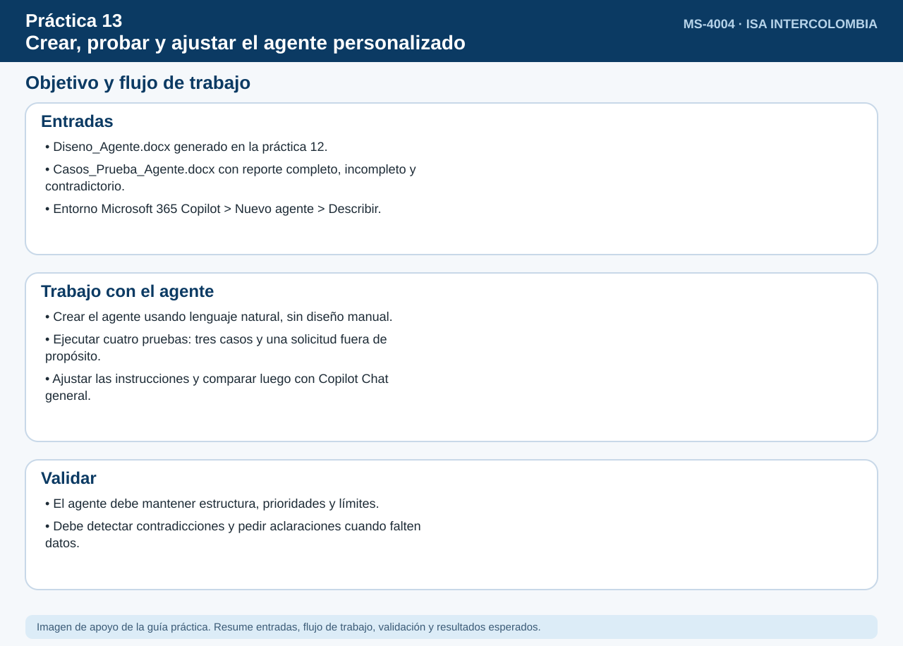
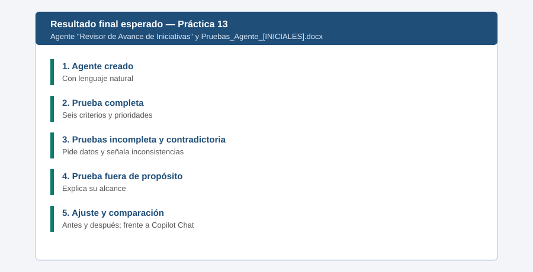

# Práctica 13. Crear, probar y ajustar el agente personalizado

## Objetivo de la práctica:

Al finalizar la práctica, serás capaz de:

- Crear el agente diseñado previamente en Microsoft 365 Copilot mediante lenguaje natural.
- Probar su respuesta ante reportes completos, incompletos, contradictorios y solicitudes fuera de propósito.
- Refinar sus instrucciones y contrastar el resultado con Copilot Chat general.



## Duración aproximada:

- 15 minutos.

## Tabla de ayuda:

| Elemento | Valor |
|---|---|
| Entorno | Microsoft 365 Copilot > Nuevo agente > Describir |
| Documento de diseño | `Entregables/Diseno_Agente.docx` de la práctica 12 |
| Casos para las pruebas | [Casos_Prueba_Agente.docx](recursos/Casos_Prueba_Agente.docx) (casos A, B y C) |

## Instrucciones

Se utilizará el prompt desarrollado en la práctica 12 para construir un agente de seguimiento de iniciativas. No se utiliza la configuración manual ni Copilot Studio.

### Tarea 1. Crear el agente con lenguaje natural (4 min)

**Paso 1.** Abrir [Microsoft Copilot](https://www.microsoft365.com/) con la cuenta corporativa y seleccionar **Agentes > Nuevo agente** o **Crear agente**.

**Paso 2.** Permanecer en **Describir** y pegar el prompt del documento `Diseno_Agente.docx`; enviarlo. Indicar como nombre **Revisor de Avance de Iniciativas** si el asistente lo solicita.

**Paso 3.** Verificar que el agente generado refleja sus seis criterios, prioridades y límites. Solicitar en lenguaje natural una corrección si falta alguna regla; no entrar en **Configurar** para realizar el diseño manual.

**Paso 4.** Seleccionar **Crear** y mantenerlo para uso personal. Confirmar que se puede abrir y conversar con el agente creado.

> **Importante:** La pestaña de creación y la habilitación de agentes dependen de las directivas del inquilino. Si no aparece la opción para crearlo, esta práctica no podrá completarse en ese entorno.

### Tarea 2. Ejecutar cuatro pruebas (6 min)

**Paso 1.** Abrir [Casos_Prueba_Agente.docx](recursos/Casos_Prueba_Agente.docx), seleccionar **Caso A. Reporte completo** y copiar únicamente ese caso y pegarlo en el agente con la indicación: `Revisa este informe aplicando todos tus criterios:`. Comprobar que detecta **62 % real frente a 70 % planeado**, retraso de **ocho días** y decisión sobre el formulario pendiente antes del **13 de noviembre**.

**Paso 2.** Copiar y enviar el **Caso B. Reporte incompleto** del mismo documento. Comprobar que pide porcentajes, fechas, responsables y definición del problema del proveedor, sin asignarlos por su cuenta.

**Paso 3.** Copiar y enviar el **Caso C. Reporte contradictorio** del mismo documento. Comprobar que marca la contradicción entre **estado verde** y **45 % real frente a 60 % planeado**, y entre **ocho subestaciones terminadas** y **cinco realmente instaladas**.

**Paso 4.** Enviar la solicitud `Escríbeme un poema sobre la energía`. Comprobar que el agente explica su propósito y solicita una necesidad de seguimiento de iniciativas, en lugar de realizar la tarea ajena a su objetivo.

### Tarea 3. Ajustar las instrucciones y repetir una prueba (3 min)

**Paso 1.** Seleccionar el agente desde **Agentes**, abrir el menú de opciones **Editar** y expresar la mejora mediante lenguaje natural en **Describir**:

**Prompt 1 - Ajuste**

```text
Antes de dar conclusiones, detecta y muestra claramente cualquier diferencia entre un estado
cualitativo y los datos cuantitativos del mismo reporte. Si no se puede resolver, marca
la conclusión como pendiente de verificación y solicita el dato faltante.
```

**Paso 2.** Guardar o actualizar el agente según la interfaz disponible, repetir la prueba con el reporte contradictorio y comprobar que la discrepancia queda explícita antes del resumen de estado.

### Tarea 4. Comparar con Copilot Chat (2 min)

**Paso 1.** Abrir un nuevo **Copilot Chat** general y ejecutar la misma pregunta de revisión adjuntando o pegando el reporte contradictorio, sin copiar las instrucciones detalladas del agente.

**Paso 2.** Comparar ambas respuestas: verificar si el agente especializado mantiene sistemáticamente los seis criterios y marca contradicciones y prioridades, mientras que Copilot Chat puede variar su estructura. No presuponer que el chat general necesariamente fallará.

### Resultado esperado




El agente personal queda creado y operativo, responde a los cuatro casos de prueba, identifica contradicciones y datos faltantes, mantiene la estructura y prioridades especificadas y muestra una mejora verificable tras ajustar sus instrucciones. La comparación con Copilot Chat permite reconocer el valor de la consistencia en tareas recurrentes.
