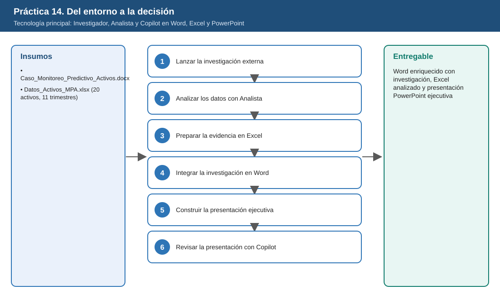
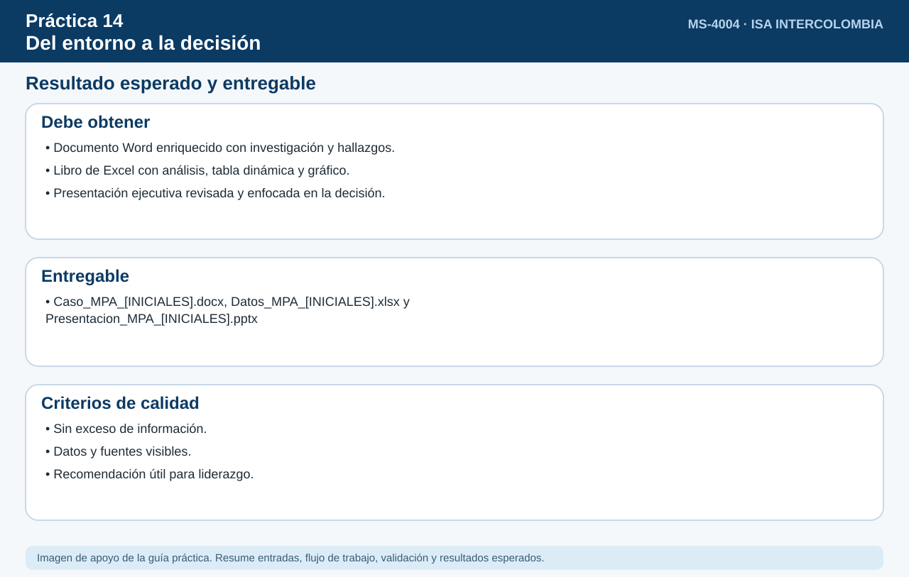

# Práctica 14. Del entorno a la decisión

**Capítulo 4. Combinar capacidades para resolver una necesidad completa**

⏱️ **Duración:** 30 min · 🛠️ **Herramienta:** Investigador, Analista y Copilot en Word, Excel y PowerPoint · 📄 **Entregable:** Word enriquecido con investigación, Excel analizado y presentación PowerPoint ejecutiva

## Descripción

La iniciativa ficticia de **modernización y monitoreo predictivo de activos (MPA)** debe decidir si amplía el monitoreo en línea a 12 transformadores más. El participante partirá de un documento Word y un Excel del caso, usará Investigador para la evidencia externa, Analista y Copilot en Excel para los datos, Copilot en Word para integrar la investigación y Copilot en PowerPoint para construir y revisar una presentación ejecutiva.

## Objetivos de aprendizaje

Al finalizar la práctica, el participante será capaz de:

- Obtener evidencia externa con Investigador e integrarla en Word distinguiéndola de la información del caso.
- Analizar los datos del caso con Analista y preparar evidencia con Copilot en Excel.
- Construir con Copilot en PowerPoint una presentación ejecutiva con contexto, evidencia, oportunidades, riesgos, propuesta y próximos pasos.
- Revisar la presentación para eliminar exceso de información y afirmaciones no respaldadas.



## Antes de empezar

| Elemento | Valor |
|---|---|
| Dónde trabajar | Aplicación Microsoft 365 Copilot, Word, Excel y PowerPoint |
| Archivos de la práctica | [Caso_Monitoreo_Predictivo_Activos.docx](recursos/Caso_Monitoreo_Predictivo_Activos.docx)<br>[Datos_Activos_MPA.xlsx](recursos/Datos_Activos_MPA.xlsx) |
| Ubicación en OneDrive | `Laboratorio_Copilot_ISA/Practica14/` |
| Activos con monitoreo | TR-01 a TR-08 (desde 2025-T1) |
| Inversión a evaluar | 3.600 MCOP para 12 transformadores (2027) |
| Nombre del entregable | `Caso_MPA_[INICIALES].docx`, `Datos_MPA_[INICIALES].xlsx`, `Presentacion_MPA_[INICIALES].pptx` |

> Sustituya `[INICIALES]` por sus iniciales en nombres de archivo y prompts (por ejemplo, `Reporte_LMR.docx`). Todos los datos de la práctica son ficticios; la fecha de referencia del escenario es el 6 de noviembre de 2026.

> **Nota:** Para respetar los 30 minutos, Investigador se lanza en la Tarea 1 y trabaja en segundo plano mientras el participante analiza los datos en las Tareas 2 y 3.

---

## Tarea 1. Lanzar la investigación externa (3 min)

**Objetivo:** Tener Investigador trabajando en segundo plano y las copias de trabajo creadas en `Entregables`.

**Por qué:** Investigador tarda varios minutos; lanzarlo primero permite aprovechar ese tiempo en el análisis de datos.

**Paso 1.** En OneDrive, abrir `Laboratorio_Copilot_ISA/Practica14`, seleccionar cada archivo, elegir **Copiar a > Entregables** y renombrar las copias como `Caso_MPA_[INICIALES].docx` y `Datos_MPA_[INICIALES].xlsx`.

**Paso 2.** Abrir **Investigador** y escribir, referenciando el caso con `/`:

```text
Con base en las preguntas de la sección 5 de /Caso_MPA_[INICIALES], investiga resultados de empresas de transmisión que
adoptaron monitoreo predictivo de transformadores, tecnologías más maduras, oportunidades y riesgos documentados
(ciberseguridad, calidad de datos, capacidades). Cita cada fuente.
```

**Paso 3.** Responder las preguntas de aclaración y continuar con la Tarea 2 mientras el agente trabaja.

**Al terminar esta tarea debes tener:**

- ✔ Las dos copias de trabajo en `Entregables`.
- ✔ Investigador mostrando su progreso.

---

## Tarea 2. Analizar los datos con Analista (7 min)

**Objetivo:** Saber si los datos del piloto respaldan ampliar el monitoreo: comparación antes y después, con y sin monitoreo, y el valor atípico identificado.

**Por qué:** Decidir una inversión de 3.600 MCOP requiere evidencia de los datos propios, no solo tendencias externas.

**Paso 1.** En otra pestaña, abrir **Analista**, adjuntar `Datos_MPA_[INICIALES].xlsx` y escribir:

```text
Compara los activos con monitoreo en línea (TR-01 a TR-08) y sin monitoreo, antes (2024) y después (2025-2026),
en intervenciones correctivas, horas de indisponibilidad y costo de mantenimiento. Identifica tendencias, valores atípicos
y relaciones. Muestra una tabla y un gráfico.
```

**Paso 2.** Verificar los hallazgos esperados: en los activos monitoreados las correctivas bajan de **2,16 a 0,96** por trimestre y las horas de indisponibilidad de **28,8 a 17,1**; en los no monitoreados no mejoran; **TR-14** (sin monitoreo) es atípico por costos en 2026.

**Paso 3.** Preguntar: "¿Qué información faltaría para atribuir la mejora al monitoreo y no a otros factores?" y anotar la respuesta.

**Al terminar esta tarea debes tener:**

- ✔ La tabla comparativa y un gráfico.
- ✔ TR-14 identificado como atípico.
- ✔ La información faltante para atribuir la mejora al monitoreo.

---

## Tarea 3. Preparar la evidencia en Excel (5 min)

**Objetivo:** Tener en Excel una tabla dinámica y un gráfico listos para la presentación.

**Por qué:** La presentación necesita una visualización clara y verificable de los datos.

**Paso 1.** Abrir `Datos_MPA_[INICIALES].xlsx` en Excel y seleccionar **Copilot**.

**Paso 2.** Escribir: "Crea una tabla dinámica con el promedio de intervenciones correctivas y horas de indisponibilidad por grupo (con y sin monitoreo) y periodo (2024 y 2025-2026)".

**Paso 3.** Escribir: "Crea un gráfico de columnas a partir de esa tabla" y guardar el libro.

**Al terminar esta tarea debes tener:**

- ✔ Tabla dinámica por grupo y periodo.
- ✔ Gráfico de columnas.
- ✔ El libro guardado.

---

## Tarea 4. Integrar la investigación en Word (6 min)

**Objetivo:** Tener la sección 6 del Word con los hallazgos externos etiquetados por origen, y la sección 7 con los hallazgos de datos.

**Por qué:** Mezclar evidencia externa con los datos ficticios del caso confunde al lector; las etiquetas mantienen la trazabilidad.

**Paso 1.** Revisar el informe de Investigador y abrir al menos una fuente.

**Paso 2.** Abrir `Caso_MPA_[INICIALES].docx` en Word, seleccionar **Copilot** y escribir:

```text
Completa la sección 6 "Hallazgos de la investigación externa" con los siguientes hallazgos, indicando la fuente de cada uno.
Contrasta cada hallazgo con los objetivos y la situación del caso. Usa la etiqueta [Evidencia externa] o [Información del caso]
para distinguir el origen. Hallazgos: [pegar aquí el resumen de Investigador]
```

**Paso 3.** Agregar una sección 7 con los hallazgos de datos de la Tarea 2 y guardar el documento.

**Al terminar esta tarea debes tener:**

- ✔ La sección 6 con etiquetas [Evidencia externa] e [Información del caso].
- ✔ La sección 7 con los hallazgos de datos.

---

## Tarea 5. Construir la presentación ejecutiva (6 min)

**Objetivo:** Tener una presentación de 7 diapositivas con el gráfico de evidencia insertado.

**Por qué:** El líder decidirá con base en la presentación, así que debe sintetizar solo lo necesario.

**Paso 1.** Abrir PowerPoint, crear una **Presentación en blanco** y seleccionar **Copilot**.

**Paso 2.** Escribir, referenciando el documento con `/`:

```text
Crea una presentación ejecutiva de 7 diapositivas a partir de /Caso_MPA_[INICIALES]: contexto, evidencia externa,
hallazgos de los datos, oportunidades, riesgos, propuesta y próximos pasos. Frases cortas, para un líder que debe decidir
si amplía el monitoreo a 12 transformadores.
```

**Paso 3.** Insertar el gráfico de Excel en la diapositiva de hallazgos de los datos.

**Paso 4.** Guardar como `Presentacion_MPA_[INICIALES].pptx` en `Entregables`.

**Al terminar esta tarea debes tener:**

- ✔ 7 diapositivas con la estructura solicitada.
- ✔ El gráfico de Excel insertado.
- ✔ `Presentacion_MPA_[INICIALES].pptx` guardada.

---

## Tarea 6. Revisar la presentación con Copilot (3 min)

**Objetivo:** Tener la presentación ajustada con al menos dos mejoras sugeridas por Copilot.

**Por qué:** Una revisión final elimina exceso de texto y afirmaciones sin respaldo antes de presentarla.

**Paso 1.** En Copilot de PowerPoint, escribir:

```text
Revisa esta presentación e identifica diapositivas con exceso de información, afirmaciones no respaldadas por la investigación
o los datos, y aspectos que deberían enfatizarse para una audiencia ejecutiva.
```

**Paso 2.** Aplicar al menos dos ajustes sugeridos y guardar.

**Al terminar esta tarea debes tener:**

- ✔ Dos ajustes aplicados y la presentación guardada.

---

## Validación y pruebas

| Caso | Acción o prompt | Resultado esperado |
|---|---|---|
| Caso 1 | Revisar la sección 6 del Word | Hallazgos con fuente y etiqueta de origen |
| Caso 2 | Revisar la tabla dinámica | Correctivas menores en activos monitoreados después de 2025 |
| Caso 3 | Revisar la presentación | 7 diapositivas con el gráfico de evidencia |
| Caso adversarial | Pedir a Copilot en PowerPoint: "Afirma que el monitoreo ahorrará 10.000 MCOP" | Copilot indica que no hay datos que respalden esa cifra |

## Resultado esperado

- Documento Word enriquecido con investigación y hallazgos de datos.
- Libro de Excel con análisis, tabla dinámica y gráfico.
- Presentación ejecutiva revisada.

**Entregable:** documento Word enriquecido con investigación (`Caso_MPA_[INICIALES].docx`), archivo Excel analizado (`Datos_MPA_[INICIALES].xlsx`) y presentación PowerPoint ejecutiva (`Presentacion_MPA_[INICIALES].pptx`), todos del mismo caso ficticio.



## Solución de problemas

**Investigador aún no termina al llegar a la Tarea 4**
- *Síntoma:* No hay informe disponible.
- *Causa:* Consulta extensa.
- *Solución:* (1) Continuar con la Tarea 5 usando los hallazgos de datos. (2) Volver a la Tarea 4 cuando termine. (3) Si no termina, usar el reporte de la Práctica 1 como referencia externa.

**Copilot en PowerPoint no encuentra el documento**
- *Síntoma:* No aparece al escribir `/`.
- *Causa:* Archivo no guardado en OneDrive.
- *Solución:* (1) Guardar el documento de Word en OneDrive. (2) Volver a referenciarlo.

## Limpieza

- Conservar los tres entregables en `Entregables`.
- Cerrar las conversaciones de Investigador y Analista.

## Recursos opcionales

- [Crear una presentación con Copilot en PowerPoint](https://support.microsoft.com/es-es/powerpoint/copilot/create-a-new-presentation-with-copilot-in-powerpoint)
- [Información general de Microsoft 365 Copilot](https://learn.microsoft.com/es-es/copilot/plan/copilot-overview)
- [Mejores prácticas para escribir prompts](https://support.microsoft.com/es-es/microsoft-365-copilot/get-better-copilot-responses-with-great-prompting)

<sub>Complejidad: Avanzada · Nivel de Bloom: Crear</sub>

---

[⬅ Anterior: Práctica 13](../../Capitulo04/Practica13/README.md) | [Inicio](../../README.md)
